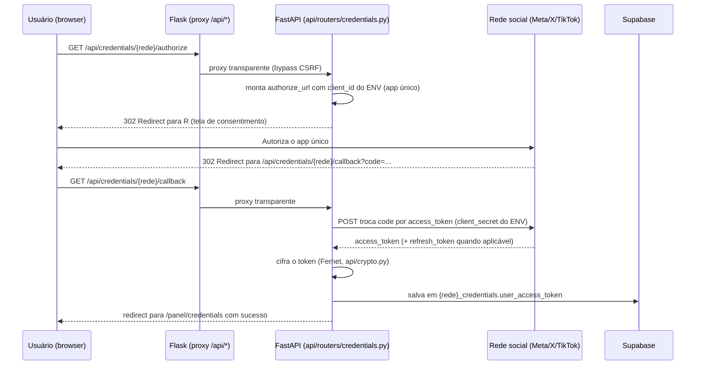

# ARCHITECTURE — Shopee Auto Vendas

> Documento canônico vivo. Cenário A (projeto existente). Toda afirmação técnica abaixo foi
> verificada lendo o código real do repositório em 2026-09-29. Itens sem evidência direta
> estão marcados **[A CONFIRMAR COM O USUÁRIO]**.

## 1. Visão geral dos componentes

O projeto está em **migração incremental**: um frontend/backend legado (Flask + Jinja2 +
Alpine.js) roda em produção hoje, enquanto um frontend/backend novo (React + FastAPI) é
construído em paralelo e já cobre as mesmas funcionalidades. Ambos coexistem no mesmo
container Docker.

```text
┌─────────────────────────────────────────────────────────────────┐
│                     Container Docker (Render)                    │
│                                                                     │
│  ┌───────────────┐   proxy /api/*   ┌──────────────────────────┐ │
│  │  Flask (web/)  │ ───────────────▶ │ FastAPI (api/) — uvicorn │ │
│  │  Gunicorn:8000 │                  │      127.0.0.1:8001       │ │
│  │  Jinja2+Alpine │                  │  routers/ auth,posts,     │ │
│  │  (legado, produção)               │  products,lists,users,    │ │
│  │                │ ◀─── bridge ──── │  credentials,notifications│ │
│  │                │   HTTP interno   │                            │ │
│  │  scheduler.init()│  (X-Internal-Secret) └──────────────────────┘ │
│  └───────┬────────┘                              │                 │
│          │                                       │                 │
│          ▼                                       ▼                 │
│   APScheduler (in-process, jobstore Postgres)     │                 │
│          │                                       │                 │
└──────────┼───────────────────────────────────────┼─────────────────┘
           │                                       │
           ▼                                       ▼
     Supabase (Postgres, RLS)               Frontend React (build
                                             estático servido pelo
                                             Flask via web/routes/spa.py)
```

Fonte: `Dockerfile`, `gunicorn.conf.py`, `web/routes/api_proxy.py`, `api/internal_client.py`,
`web/routes/internal.py`.

## 2. Stack real

| Camada | Tecnologia | Função |
| --- | --- | --- |
| Frontend legado (produção) | Flask 3.x + Jinja2 + Alpine.js + Tailwind CSS (build local) | Painel atual do usuário |
| Frontend novo (em migração) | React 19 + TypeScript estrito + Vite 6 + TanStack Router + TanStack Query + Zustand + Tailwind CSS v4 + Lucide React | Novo painel, substitui o Jinja gradualmente |
| Backend legado | Flask 3.x, Flask-Login, Flask-WTF, Flask-Limiter, Flask-CORS | Rotas `web/routes/panel/`, ainda em produção |
| Backend novo | FastAPI (async), Pydantic-settings | Rotas `api/routers/`, roda em subprocesso uvicorn no mesmo container |
| Scheduler | APScheduler 3.11, jobstore `SQLAlchemyJobStore` sobre Postgres | Jobs de publicação e atualização de produto, in-process |
| Banco | Supabase (Postgres gerenciado), RLS habilitado em todas as tabelas, acesso via `psycopg` (não `supabase-py` no lado Flask) e cliente Python async no lado FastAPI | Persistência |
| Mídia | Cloudinary (host temporário) | Upload/hospedagem de imagem de post |
| IA | Gemini / OpenAI / Anthropic com chave por usuário (`apis/llm.py`, tabela `ai_credentials`) | Copywriter de post por persona |
| Cripto | `cryptography` (Fernet) — `utils/crypto.py` (Flask) e `api/crypto.py` (wrapper compatível, FastAPI) | Cifra credencial de rede social em repouso |
| Infra/Deploy | Render (Web Service, Docker, plano Free), GitHub Actions (CI) | Deploy automático a cada push em `main` |
| WSGI/ASGI | Gunicorn + gevent (Flask), Uvicorn (FastAPI) | Servidores de aplicação |

## 3. Estrutura de pastas real

```text
shopee_bot-main/
├── api/                     # API nova (FastAPI), roda em paralelo ao Flask
│   ├── main.py              # app FastAPI
│   ├── config.py            # pydantic-settings (SUPABASE_URL/KEY etc.)
│   ├── database.py          # _SupabaseProxy — acesso lazy ao Supabase
│   ├── crypto.py            # Fernet, compatível com utils/crypto.py do Flask
│   ├── internal_client.py   # chama o bridge HTTP interno do Flask
│   ├── middleware.py
│   ├── {threads,x,tiktok,instagram,facebook}_oauth.py  # OAuth de app único por rede
│   └── routers/
│       ├── auth.py          # login/logout/register — cadastro público força access="USER"
│       ├── credentials.py   # SIMPLE_NETWORKS (Shopee/Kwai) x OAUTH_NETWORKS (as 5 outras)
│       ├── posts.py         # CRUD de post, thread, upload de mídia, copy IA
│       ├── products.py
│       ├── lists.py
│       ├── users.py         # admin-only
│       ├── dashboard.py
│       └── notifications.py
├── apis/                    # wrappers de API de terceiros (Shopee, Threads, X, TikTok, Facebook, Instagram, llm)
├── database/                # acesso ao Postgres/Supabase usado pelo Flask legado
│   └── migrations/          # SQL numerado sequencialmente
├── scheduler/                # APScheduler in-process
│   ├── bot_post.py           # Threads (original)
│   ├── bot_post_x.py
│   ├── bot_post_facebook.py
│   ├── bot_post_instagram.py
│   ├── bot_post_tiktok.py
│   └── update_products.py
├── web/                      # Flask legado, ainda em produção
│   ├── routes/
│   │   ├── panel/            # credentials.py, profile.py
│   │   ├── api_proxy.py      # proxy transparente /api/<path> -> FastAPI interno
│   │   ├── internal.py       # bridge HTTP interno (add_job/remove_job/run_job/query_auth_validate)
│   │   └── spa.py            # serve o build do React
│   ├── templates/, static/, media/
├── frontend/                  # React novo
│   └── src/
│       ├── pages/             # DashboardPage, LoginPage, PanelPage, PostsPage, ProductsPage, ListasPage, CredentialsPage, ProfilesPage, SettingsPage
│       ├── components/ui/     # design system (ver DESIGN.md)
│       ├── api/                # clientes HTTP tipados
│       ├── stores/              # Zustand (auth)
│       └── styles/tokens/       # colors/typography/fonts/spacing/radius/elevation/motion
├── docs/                       # documentação da migração e docs canônicos (este arquivo)
├── vault/                       # ponteiro pro vault Obsidian (não duplica conteúdo)
└── tests/
    └── api/                     # testes da API FastAPI, isolados do conftest do Flask
```

## 4. Fluxo OAuth "app único" (peça arquitetural mais distintiva)

Para Threads, X, TikTok, Instagram e Facebook: **um único app** é registrado no painel de
desenvolvedor de cada rede (por Rafa/dono do SaaS), com `client_id`/`client_secret` vindos de
variável de ambiente (`api/x_oauth.py`, `api/tiktok_oauth.py`, `api/instagram_oauth.py`,
`api/threads_oauth.py`, `api/facebook_oauth.py`). O usuário final nunca vê nem cola essas
credenciais — só clica "Conectar [rede]" e autoriza. Shopee e Kwai não têm OAuth público e
seguem o modelo manual (usuário cola App ID/Secret do próprio Portal de Afiliados).



**Estado real (2026-10-09)**: o fluxo acima está implementado nas 5 redes. Threads conecta
para a conta `rafastudio`/AMD, mas usuário comum pode ser bloqueado pelo próprio Meta quando
o app ainda exige convite de tester aceito (`error_code=1349245`). TikTok chegou a falhar no
provedor por `redirect_uri`: o Live do Login Kit tinha apenas a URI de produção, enquanto o
staging envia `https://shopee-bot-staging.onrender.com/api/credentials/tiktok/callback`.
Depois de cadastrar também a URI de staging e servir o arquivo de verificação de URL prefix,
Rafa confirmou que a conexão/autorização TikTok funcionou no staging e a conta ficou
conectada. O `redirect_uri` enviado ao TikTok deve continuar preservado exatamente como
`TIKTOK_CALLBACK_URL`, porque o Login Kit valida a URI cadastrada. Token novo vem de novo
OAuth, não de cópia manual do portal (ver `docs/MEMORY.md`).

## 5. Bridge interno Flask ↔ FastAPI

A API nova não importa `scheduler`/`apis.shopee` diretamente — chama por HTTP interno
(`api/internal_client.py` → `web/routes/internal.py`), autenticado por segredo compartilhado
(`X-Internal-Secret`, isento de CSRF). Motivo documentado no código: rodar
`scheduler.init()` em dois processos simultâneos arriscaria duas instâncias do APScheduler
ativas publicando o mesmo job em duplicata — por isso **só o Flask** chama
`scheduler.init()`; a API nova pede `add_job`/`remove_job`/`run_job`/`query_auth_validate`
via bridge.

## 6. Segurança (arquitetural)

- Credenciais de rede social cifradas em repouso (Fernet, chave `APP_ENCRYPTION_KEY`, com
  rotação/fallback documentados no `README.md`).
- Rate limiting (Flask-Limiter) nas rotas de credenciais e login.
- CSRF global (Flask-WTF) exceto para `/api/*` (proxy, bypass documentado).
- CSP, X-Frame-Options, HSTS configurados.
- Handler de exceção genérico em produção (não vaza traceback).
- Cookie de sessão `Secure; HttpOnly; SameSite=Lax`.

## 7. Decisões arquiteturais registradas (ADRs no vault)

- **Scheduler in-process** (não separar em worker) — `19-ADR-Scheduler-In-Process.md`
  (vault). Gatilho de revisão: hospedagem de produção real de fato ativa, volume de posts
  crescer, ou necessidade de múltiplas instâncias simultâneas.
- **Coexistência Flask+FastAPI no mesmo container** em vez de dois Web Services separados no
  Render — decisão tomada por custo/complexidade (Fase 8.1 do roadmap de migração).
- **App único de OAuth** (substituindo o modelo per-user anterior para X/TikTok/Instagram) —
  detalhe completo em `27-Migracao-App-Unico-OAuth.md` (vault).

## 8. Atualização 2026-10-05 — multi-perfil e endurecimento (branch `chore/phase-12-integration`)

> Nota datada: as seções 1-7 refletem a verificação de 2026-09-29 e foram mantidas. Correções e
> acréscimos verificados no código desta branch:

- **Correções ao texto acima**: (a) o gunicorn escuta em `$PORT` (default 5000,
  `gunicorn.conf.py`), não em 8000 como no diagrama da seção 1; (b) o redirect pós-OAuth da API
  nova vai para `{FRONTEND_URL}/credentials` (`api/routers/credentials.py`), não `/panel/credentials`;
  (c) além dos routers listados na seção 3 existem `profiles.py`, `settings.py`, `catalog.py` e
  `logs.py`.
- **Perfil ativo**: o JWT (cookie httpOnly) carrega `sub`, `id`, `profile_id` e `pwv`. O backend
  valida que o `profile_id` pertence ao usuário e, se não pertencer, cai no perfil principal
  (`api/routers/profiles.py::_resolve_profile_id`). `GET /auth/me` devolve o `profile_id` ativo.
  Tabelas com `profile_id` (FK `ON DELETE SET NULL`): `products`, `product_lists` (036) e, pela
  038, credenciais das 7 redes, `credential_checks`, `posts`, `medias`, `schedulers`,
  `activities`, `request_logs`, `audit_events`. O scheduler e os bots usam a credencial e as
  atividades do perfil do post, com fallback por `user_id`.
- **Banco**: migração 037 (trigger `trg_enforce_profile_limit`, limite de 3 perfis, advisory
  lock), 038 (colunas/índices/backfill), 039 (remove UNIQUE de `shopee_credentials.app_id`; check
  de credencial passa a ser por `(user_id, profile_id, network)`) e 040 (índice único de `credential_checks` com coalesce para deduplicar NULLs). Migrações vão até a 042.
- **Auth**: a troca de senha muda o hash e invalida tokens antigos (claim `pwv`, comparado em
  `api/routers/auth.py`); tokens emitidos antes do claim existir continuam aceitos.
- **Container**: `Dockerfile` roda como usuário não-root (uid 10001) com `HEALTHCHECK` em
  `/health`; `gunicorn.conf.py` com `timeout = 120` e thread supervisora que reinicia o uvicorn
  com backoff.
- **CI/CD**: ver `docs/RULES.md` itens 2 e 3 (flake8 bloqueante, job `frontend`, CD via
  `workflow_run`).

## 9. Composição de mídia por rede (design aprovado, 2026-10-11)

O criador de posts passará a montar um plano de publicação para cada rede escolhida. O navegador
mostra variantes e alertas, mas o backend recalcula a compatibilidade antes de criar os posts e
antes de disparar o scheduler. Cada post do mesmo `group_id` poderá apontar para uma seleção e
ordem próprias em `posts_medias`, sempre escopadas pelo par `user_id` + `profile_id`.

Mídia incompatível não é erro global: quando houver endpoint textual, o plano marca a rede como
`text_only`; quando a API exigir mídia, marca `blocked_reason` e mantém as demais redes em
publicação. Sem variante de texto válida, somente a rede afetada é excluída do envio. O design
também prevê upload temporário antes de criar posts, pois o endpoint atual anexa o arquivo
imediatamente ao primeiro post e não permite seleção distinta por rede.

Detalhes, contratos e critérios de aceite:
`docs/superpowers/specs/2026-10-11-composicao-midia-por-rede-design.md`.

## 10. Conta, perfis e papeis (migracao em staging, 2026-10-11)

O usuario possui uma conta e no maximo tres perfis, contando o perfil principal. A conta e dona
dos recursos que devem acompanhar qualquer perfil: credencial Shopee, configuracao/chave do
assistente e catalogo de produtos salvos. Esses recursos usam somente `user_id`.

Os recursos operacionais usam sempre `user_id` + `profile_id`: conexoes OAuth e seus checks,
listas, posts, midias, agendamentos, resultados, notificacoes e preferencias de publicacao.
Assim, trocar de perfil reutiliza produtos, Shopee e IA, mas nunca mistura contas sociais ou
historico de publicacao.

O frontend entrega as telas comuns para qualquer pessoa. `Perfis` continua comum; `Usuarios`,
`Logs` e overrides manuais de redes sociais sao modulos ADMIN carregados sob demanda. Uma URL
administrativa acessada por USER volta silenciosamente a area comum. Isso e somente uma camada
de experiencia: cada rota administrativa tambem exige ADMIN no backend.

Para USER, redes sociais sao conectadas exclusivamente pelo OAuth da conta ativa. Somente
Shopee e IA recebem chave informada pelo proprio usuario. ADMIN tambem pode usar os overrides
manuais das redes para homologacao, sem que esse codigo ou pistas de administracao sejam
carregados na sessao comum.

A migracao `045_share_account_catalog_credentials.sql` esta pronta no branch `staging` e falha
antes de escrever se encontrar dados compartilhados divergentes. Sua aplicacao no Supabase e a
validacao em staging continuam pendentes da promocao/deploy deste conjunto.

## Referências

- `README.md`, `api/README.md`, `docs/ROADMAP_MIGRACAO.md`
- Vault Obsidian: `02-Arquitetura-e-Tecnologias.md`, `arquiteturas.md`,
  `07-Diagrama-de-Arquitetura.md`, `19-ADR-Scheduler-In-Process.md`,
  `27-Migracao-App-Unico-OAuth.md`, `26-Deploy-Render.md`
