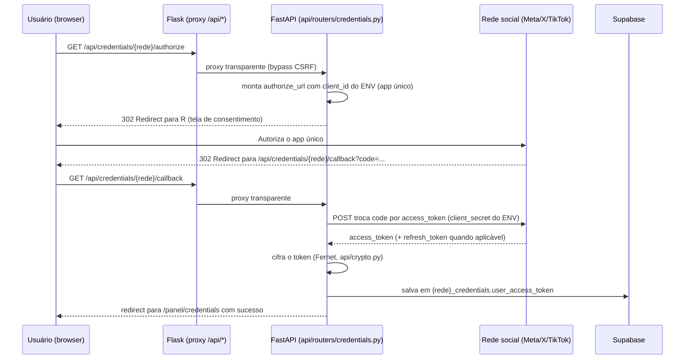

> **08/11/2026 — ARQUITETURA PUBLICADA NA RELEASE 3.6.1:** `api.media_upload_pipeline.prepare_media_upload` unifica Produtos/Posts; MP4 admite `uuid` top-level limitado somente no preflight, reencoda FFmpeg, valida estritamente saída antes de Storage; imagens seguem Pillow; XHR com credenciais exibe progresso real separado de processamento em skeleton. `main` SHA `982a58351bec2cdc42a80ad0aff728e02ae7f648`, Render `dep-dboe4uvb9u1s73dinre0` LIVE, health/readiness OK, UI 3.6.1; staging funcionalmente igual. Sem banco/cron/gateway alterado. [Evidências](RELEASE-3.6.1-20261108.md).

> **08/11/2026 — PATCH DE PIPELINE DE MÍDIA EM PREPARAÇÃO STAGING:** `api/media_upload_pipeline.py` recebe uploads autenticados de Produtos/Posts: imagem segue Pillow; vídeo MP4 faz preflight ISO BMFF limitado, com `uuid` top-level aceito até 1 MiB e até 4 caixas, exige `moov`/`mdat`, ffprobe + FFmpeg reencodam H.264/AAC sem metadados e o sanitizador final mantém allowlist estrita. XHR multipart com cookie e onprogress alimenta UI de anel e skeleton, separando transferência e processamento. Sem mudanças em Storage buckets, RLS, filas, DB, cron ou produção; [contrato/risco/testes](UPLOAD-MP4-PROGRESSO-20261108.md). Candidata PATCH 3.6.1, versão vigente 3.6.0.

> **08/11/2026 — ARQUITETURA DA RELEASE 3.6.0 PUBLICADA:** no fluxo de Produtos, `products.description` é a origem persistida; GET de listas deve retornar `description`, posts novos preenchem `texts[0]` sem substituir edições locais, campanhas criam `itemSnapshots[id].copy` e geram IA por item sem modificar a origem. Imagem principal Shopee é obtida por endpoint autenticado e sanitizador com allowlist HTTPS, ownership e limite de tamanho; sem novo Storage ou URL arbitrária enviada pelo navegador. `staging` → [PR #357](https://github.com/raffastudioproducoes-cloud/shopee_bot-main/pull/357) → `main` `699e81bd18e2b12fc3824f914045627a45844cc2` → Render `dep-dbod0q7b9u1s73dhci7g` LIVE com saúde OK. Sem migration, RLS, scheduler, cron, gateway, redes ou serviços novos. [Release](RELEASE-3.6.0-20261108.md) · [Contrato](PRODUTOS-DESCRICOES-CAMPANHAS-20261108.md). Entradas antigas abaixo descrevem o estado anterior.

> **07/11/2026 — ARQUITETURA VIGENTE NA RELEASE 3.5.0:** as funcionalidades acumuladas em staging foram publicadas em `main` SHA `435c80af` ([PR #351](https://github.com/raffastudioproducoes-cloud/shopee_bot-main/pull/351)), Render LIVE e readiness 200. **React/Vite + Flask proxy + FastAPI + Supabase compartilhado**, não Next.js. O backend usa service role com escopo de aplicação; RLS ativo não substitui os testes de ownership. O diagnóstico read-only de 63 tabelas `public`, grants/policies e as demais seis categorias está em [auditoria 07/11](SEGURANCA-AUDITORIA-20261107.md); a rotina repetível é [checklist](SEGURANCA-VARREDURA-CHECKLIST.md). Nenhuma remediação de risco foi implantada por essa auditoria; o plano depende de PR e gate separado. [Release](RELEASE-3.5.0-20261107.md).

> **05/11/2026 — paginação incremental de Posts (staging):** `/posts` mantém `useInfiniteQuery` e `GET /posts` com cursor/escopo de perfil já existentes, sem mudar API/banco. `postHistoryPagination.ts` define páginas visíveis de 15; `PostsPage.tsx` faz fetch em blocos de 90 (6 páginas visuais completas), filtra com `matchesPost` antes do corte, reaproveita páginas em cache, busca o próximo cursor ao esgotar itens carregados e reinicia/clampa índice quando busca/perfil ou quantidade mudam. Busca ativa continua carregando páginas antigas até encerrar o cursor; navegação não mistura outros perfis. Nenhuma mudança em cron, scheduler ou filas.

> **05/11/2026 — classificação de Listas por uso real (staging):** `frontend/src/lib/listSorting.ts` implementa os 10 sentidos determinísticos (nome, criação, itens, última edição e campanhas ativadas) após o filtro contextual. `ListasPage` consulta `GET /lists/usage` apenas para o critério de uso; React Query tem chave por conta/perfil e apresentação de erro sem inventar contagens. O endpoint em `api/routers/lists.py` usa `get_current_user_id`/`get_current_profile_id`, consulta paginada somente de `source_list_id:draft_snapshot->>source_list_id` em `campaign_reservations_f4e` com `activated_at IS NOT NULL`, e soma uma ocorrência por reserva efetivamente ativada. Não consulta mídia/texto das campanhas, nem altera cron, banco, scheduler, schema, índices ou contratos de publicação. O histórico de uso é por campanha ativada, não por item/post nem por rascunho; canceladas após ativação continuam registradas. O limite de até 100 listas carregadas na página permanece conhecido; o histórico de ativação é lido em páginas de 500 registros sob demanda. Feature compatível MINOR candidata 3.3.0.

> **05/11/2026 — pesquisa contextual compartilhada (somente staging):** `frontend/src/lib/pageSearch.ts` concentra a resolução da barra superior por rota e um matcher local seguro (normalização, aliases/sinônimos). `PanelPage` conecta estados isolados de Produtos, Posts e Listas; `ListasPage` filtra exclusivamente listas e produtos recebidos do perfil (API com limite até 100), `ListModal` usa o mesmo matcher, e `postPresentation.matchesPost` preserva seu índice textual com matcher comum. `ProductsPage` conserva `GET /products?search=...` com `api/product_search.py` como expansão autoritativa no servidor e `user_id` no filtro; frontend não consulta produtos de outros perfis/contas. TopBar sem filtro funcional ocultada, dashboard sem busca e pesquisa avançada independente. Sem alteração de API, banco, RLS, cron, publicadores ou infraestrutura. MINOR absorvida em 3.3.0 (VERSION=3.2.0 em staging).

> **05/11/2026 — Geração de descrição de produto (somente staging):** `POST /posts/generate-copy` recebe flag retrocompatível `description_only` (uma parte, sem redes/append) e reutiliza autenticação, escopo da conta, rate limit, seleção da chave pessoal Gemini e `apis.llm.complete` do compositor. `api/text_variants.py` remove links e limita o retorno a 280 caracteres ponderados pelo X; `ProductUpdate` revalida. O cliente não persiste o resultado sem ação Salvar. `AiCopyControls` compartilha estilos e botão entre Criar Post e Produtos; galeria do produto mantém upload privado já implementado. Não introduz endpoints, tabelas, chaves globais, filas, cron ou mudanças no main.

> **04/11/2026 — ESTADO ATUAL/RELEASE 3.2.0 EM REGULARIZAÇÃO:** PR #269 integrou a dashboard agregada por conta e o fluxo de arquivamento na `main` (CI #951; Render `dep-dblpjblg1s2s73c32i60` LIVE, commit `5b7b040`). A exclusão física legada de perfis foi bloqueada pelas migrações 085/086 do Supabase único; arquivamento é lógico via RPC, preserva posts e resultados finais, cancelando apenas pendentes conforme status. `PROFILE_ARCHIVAL_ENABLED` e `ACCOUNT_ERASURE_ENABLED` continuam OFF por padrão até homologação/ativação específica. A anotação histórica abaixo de PR #265/pré-arquivamento não descreve mais o código implantado. Release SemVer 3.2.0 será confirmada após CI/deploy próprios.

> **Dashboard geral da conta — alteração em PR #265 de staging (04/11/2026, ainda não aprovada):** `GET /dashboard/stats` usa somente o `user_id` autenticado como limite de agregação dos cards, com `posts.post_id IS NULL` para não duplicar partes de posts; registros com `profile_id IS NULL` continuam contados. Os arrays `recent_posts` e `recent_activities` (até 5) têm escopo de conta; `null` sinaliza indisponibilidade parcial, `[]` ausência real. Rotas de criação permanecem sujeitas ao guard do plano, e operações de listagem/edição/publicação seguem isoladas por perfil ativo. O `DELETE /profiles/{id}` atual é físico: FKs de campanhas F4E em CASCADE não cumprem retenção integral. Exige decisão de arquivamento/migração separada e coordenação de main/staging por compartilharem Supabase. Não alterar agendadores, pg_cron ou regras operacionais para este ajuste de dashboard.

> **04/11/2026 — CORREÇÃO CANÔNICA DE ARQUITETURA (verificada no banco, não hipótese):** `pg_cron` do único Supabase controla `auto-orbital-wake-v1` a cada 2 min; `app_internal.wake_dispatch_if_needed()` consulta `apscheduler_jobs`/`schedulers` e `publish_jobs`, e quando há trabalho usa `pg_net.net.http_post` com endpoint/credencial do Supabase Vault para despertar o Render. Render/APScheduler continua responsável pelo processamento; SQL `succeeded` não comprova HTTP nem postagem final. **Estado atual pós-ajuste autorizado de 04/11:** existem só dois cron jobs ativos: uptime via `public.admin_uptime_tick()` (`auto-orbital-uptime-sample-v1`, `*/12 * * * *`) e wake de publicações (`auto-orbital-wake-v1`, `*/2 * * * *`, sem alteração). O cron ADMIN de capacidade diária foi desagendado, preservando funções/tabelas. A aferição histórica anterior usava uptime a cada 5 min. **Não migrar cron, backend ou Render por interpretação genérica de hibernação**; primeiro auditar a arquitetura real em Supabase, código e logs. Esta nota prevalece sobre recomendações históricas de upgrade.

> **04/11/2026 — Restrição arquitetural ativa:** apenas um Supabase/Postgres para `main` e `staging`; branches Render separadas, processamento protegido por origem/ambiente e jobstores segregados. A produção não pode sofrer parada durante evolução de banco, API ou workers. Adotar migrations aditivas compatíveis e rollout progressivo staging → main, com prontidão e logs. Deploy rolling e drain do worker antigo não significam pausa solicitada; saúde e tráfego devem permanecer íntegros. Render Free atualmente tem 1 instância por site e pode dormir em inatividade; isso afeta latência/disponibilidade HTTP do site, mas **não justifica recomendar migração do executor de posts**: o Supabase possui `pg_cron`/`pg_net` com despertar sob demanda já implantado. Verificar o acionamento real antes de inferir impacto em agendamentos; nenhuma migração está autorizada. Nota vinculante em AGENTS.md, RULES e TASK.
> **03/11/2026 — F4E-2B2 PREPARATÓRIA STAGING LIVE (registro pós-deploy, prevalece sobre notas PRE-DEPLOY):** PR [#234](https://github.com/raffastudioproducoes-cloud/shopee_bot-main/pull/234) squash `0483b7a2912e90a7b93d41d9982b0048674853c0`, [CI #41713751800](https://github.com/raffastudioproducoes-cloud/shopee_bot-main/actions/runs/41713751800) SUCCESS. O filtro do teste SQL F4E-2B2 não estava incluído nessa primeira CI; corrigido na PR [#235](https://github.com/raffastudioproducoes-cloud/shopee_bot-main/pull/235), squash `136302434bc10a3f67cb24ede4a4d0db02cbe226`, [CI #41714645658](https://github.com/raffastudioproducoes-cloud/shopee_bot-main/actions/runs/41714645658) SUCCESS: 15 contratos F4E-1 em PostgreSQL descartável e 3 contratos estáticos F4E-2B2. [CI staging #41714932997](https://github.com/raffastudioproducoes-cloud/shopee_bot-main/actions/runs/41714932997), [smoke HTTP #41714932664](https://github.com/raffastudioproducoes-cloud/shopee_bot-main/actions/runs/41714932664) e [ZAP passivo #41714932408](https://github.com/raffastudioproducoes-cloud/shopee_bot-main/actions/runs/41714932408) SUCCESS; smoke autenticado SKIPPED por ausência de credenciais. Render `dep-dbl4e317lnhs739rukhg` **LIVE** no SHA `1363024`. Supabase read-only: reservas=0, ocorrências=0, tabela proposta de vínculos inexistente. **Só contrato inerte e política documental de downgrade aprovada**; não há guardas de executor conectados, alteração de `main`, migração, reserva executável, publicação ou cobrança; `VERSION=3.0.0`. Ver [escopo F4E-2B2](F4E-2B2-IDENTIDADE-INERTE-20261103.md).

> **03/11/2026 — F4E-2B2 PREPARATÓRIA (PR/CI/deploy ainda não verificados):** Rafa aprovou a política de downgrade Premium→Pro: pausar todas as campanhas existentes até o titular escolher no máximo 2 por perfil; preservar as demais e o histórico, sem ativação automática. Corrigido o contrato de identidade para UUID em scheduler/publish_job (post_id INTEGER); guarda continua sempre recusando. Proposta SQL de vínculo persistente inerte permanece **fora do migrador**, não aplicada ao Supabase. Nenhuma integração ao executor, reserva executável, job ou publicação; `main` intocada, `VERSION=3.0.0`. Exige proteção no claim, retry, recovery, pré-envio e rollout compatível em ambos os ambientes antes da ativação. Ver [F4E-2B2 — identidade inerte](F4E-2B2-IDENTIDADE-INERTE-20261103.md).\n\n> **03/11/2026 — F4E-1: DDL inerte aplicada ao Supabase compartilhado, ainda em PR draft.** Por coordenação de Rafa, a migration Supabase `20261103191911 / 074_f4e1_inert_campaign_reservations` foi aplicada; `public.migrations` recebeu `074_f4e1_inert_campaign_reservations.sql`. A inspeção reportada após a aplicação encontrou zero reservas e ocorrências, RLS ativo sem policies, anon/authenticated sem acesso e service_role com SELECT/RPC, sem DELETE. Draft legado preservado. Não foram criados jobs F4E, executor ou publicações, nem houve merge ou deploy de main/produção. [PR draft #229](https://github.com/raffastudioproducoes-cloud/shopee_bot-main/pull/229); [CI #755](https://github.com/raffastudioproducoes-cloud/shopee_bot-main/actions/runs/41701678290) verificou a proposta anterior. Rafa validou em mobile tags, mensagens e perfil; escolha de plano permanece futura. F4E-2, validação por rede e retenção física de mídia continuam pendentes. VERSION permanece 3.0.0. Esta nota prevalece sobre estados anteriores abaixo.

> **03/11/2026 — F4D em PR, ainda sem merge/deploy:** interface de plano canônico da conta, badges Free/Pro/Premium/Administrador e consumo exato de produtos/conta, listas/perfil e perfis/conta via `GET /profiles/usage` autenticado/read-only. Conta/papel e limites são relidos no servidor; `profiles.plan_tier` não decide assinatura. Consumo de Agora/recorrência permanece indisponível (`null`), não zero fictício. Campanha respeita caps do servidor (Pro 15/3, Premium 30/15, ADMIN limites físicos), Free não cria/edita/upload/prévia, preservando leitura/exclusão do legado. Automação é vitrine, mesmo Premium/ADMIN: direito não significa executor. CTA informacional, sem preços, checkout ou alteração de plano. Nenhuma migration/SQL, scheduler, ativação, job, postagem ou mudança de main. `VERSION=3.0.0`. CI/QA/deploy não confirmados nesta nota. Ver [contrato F4, seção 10](PLANOS-F4-POLITICAS-E-FASES-20261103.md#10-f4d--interface-de-plano-consumo-e-acesso).

> **03/11/2026 — F4C2 guardas de campanha integradas em staging (evidência pós-merge):** [PR #217](https://github.com/raffastudioproducoes-cloud/shopee_bot-main/pull/217) squash-merge **somente staging** SHA `d80f60d289c314064fa6ac728c4b23f898a767c2`, [CI #722](https://github.com/raffastudioproducoes-cloud/shopee_bot-main/actions/runs/41692608479) SUCCESS (API 1.157, scheduler 175 + 1 xfailed, SQL 4, web 27, frontend/build aprovados). Render staging `dep-dbl2d1k9v7es73datmag` LIVE no SHA; navegador confirmou `/health` e `/api/health/ready` = `{"status":"ok"}`. Free bloqueado para novas campanhas; Pro até 15 dias e 3 unidades de rede/dia, Premium até 30 dias e 15; ADMIN bypass comercial com ownership e segurança. **F4C2 é preparatória:** não há ativação nem automação operacional; 2/5 campanhas ativas exigem reserva atômica F4E. Nenhuma migration 074/SQL, postagem ou alteração de `main`/produção. `VERSION=3.0.0` inalterada. QA de usuário autenticado e concorrência real ainda pendentes. Esta nota prevalece sobre fotografias pré-merge abaixo.

> **03/11/2026 — F4C2, histórico da preparação pré-merge:** campanhas Free bloqueadas nas entradas de prévia/criação/edição/upload; Pro até 15 dias inclusivos e 3 publicações/dia, Premium até 30 dias e 15/dia; cada rede conta uma unidade no rascunho com planejamento. ADMIN ignora cotas comerciais, não segurança/ownership nem teto absoluto de 30 dias. Política de conta e limites auditados são relidos no servidor sem cache. Leitura/exclusão de rascunho legado permanecem disponíveis após downgrade. Não há ativação nem automação operacional: limite de 2/5 campanhas ativas ainda depende de reserva transacional na F4E; consumo retorna `null`, nunca zero fictício. Sem migration 074 nem mutação de banco. Ver [contrato F4](PLANOS-F4-POLITICAS-E-FASES-20261103.md), seção 8.

> **Decisão confirmada F4B2 em 03/11/2026:** perfil principal obrigatório. Free = 1 perfil total (nenhum adicional); Pro = 3 totais (1+2); Premium = **5 totais** (1+4); ADMIN sem limite comercial. Compartilhados na conta: produtos, Shopee, IA/Gemini. **Isolados por perfil: listas (Rafa confirmou manter), social OAuth, posts criados/agendados/publicados/recorrentes, histórico, campanhas e mídias.** Aplicação gradual no staging: RPC de perfil respeita limites e trigger legado segura `main` em três perfis até release próprio. Ver [contrato F4](PLANOS-F4-POLITICAS-E-FASES-20261103.md). Status não equivale a DB aprovado/deploy concluído.

> **Contrato F4 de 03/11/2026 (a implementar progressivamente):** catálogo compartilhado por conta, listas/posts/campanhas por perfil; plano de assinatura da conta e bypass comercial por papel ADMIN no servidor. A coluna legada `profiles.plan_tier` só admite `free|plus|premium` antes de migração; não escrever `pro` nela sem DDL compatível. Ver [matriz e fases F4](PLANOS-F4-POLITICAS-E-FASES-20261103.md). Até a fase de enforcement, UI/etiqueta não é controle de acesso.

> **02/11/2026 — Correção de isolamento entre os schedulers de staging e main (implantação em etapas):** o mesmo Supabase permanece, mas agendas novas terão `schedulers.environment` conforme o branch Render; jobs anteriores ficam na produção. APScheduler passa a usar `apscheduler_jobs` em main e `apscheduler_jobs_staging` em staging; recuperação/claims da fila verificam o ambiente e dono. Ativação de staging só depois de a main receber estes filtros. Detalhes, verificação e rollout em [SCHEDULER-ENVIRONMENTS-20261102.md](SCHEDULER-ENVIRONMENTS-20261102.md). Nenhuma publicação externa é validada por CI.\n\n> **02/11/2026 — Identidade e concorrência de posts (somente staging; aguardando CI/PR):** `posts.id` numérico já é único e crescente (mesmo após exclusão), agora exposto como `#ID` na lista e nos detalhes. O agrupamento visual usa apenas `group_id` explícito; fluxo “Agora” separa criação confirmada de disparo não confirmado; fila e leituras exigem correspondência entre usuário, perfil, post e agenda. Auditoria do banco compartilhado em leitura encontrou zero vínculos cruzados na amostra existente. **Scheduler de staging continua desligado** para não executar agendas da produção no Supabase compartilhado. Detalhes, limites e QA em [POSTS-IDENTIDADE-CONCORRENCIA-20261102.md](POSTS-IDENTIDADE-CONCORRENCIA-20261102.md). Não alterar `main`/produção.

> **02/11/2026 — Correção dos posts em desenvolvimento (staging, ainda não publicada):** seleção de um produto, retirada de agendamento avulso, seletor desktop em 24h, histórico do estado de cada ocorrência, última postagem confirmada e erro simplificado para usuário. Supabase compartilhado impede apagar esquema/legado; erro HTTP 403 do Threads precisa de código Meta e autorização antes de declarar publicação funcionando. Detalhes e QA: [POSTS-AJUSTES-RECORRENCIA-20261102.md](POSTS-AJUSTES-RECORRENCIA-20261102.md). **Não alterar main/produção.**

> **Arquitetura real de 31/10/2026:** React é o painel padrão; Flask serve SPA/proxy e Uvicorn roda interno. Topologia, ambientes, RLS e limites no Guia Mestre. **Primeira leitura obrigatória:** [AGENTS.md](../AGENTS.md) e [docs/GUIA-MESTRE-IA.md](GUIA-MESTRE-IA.md).

# ARCHITECTURE — Shopee Auto Vendas

> **07/11/2026 — Shopee API global em staging, candidata 3.5.0:** `api/routers/platform_shopee.py` lê App ID e Secret de `platform_shopee_credentials` com `current_environment()` e `api/crypto.py`; credencial global por branch Render, gerida somente em `/admin/shopee`. `shopee_affiliate_accounts` associa ID numérico à conta; links são compostos com `api/shopee_affiliate_links.py` usando URL original da Shopee e `affiliate_id` individual. `/products/catalog-search` descarta `offerLink` de resultado do app ADMIN. Leitura de produtos/listas reescreve respostas antigas sem DML; criação de produto e novo snapshot de campanha substituem link do cliente por um construído pelo servidor. Migração 090 apenas aditiva, serviço principal 3.4.0 permanece compatível. Histórico de anúncios não é reescrito. [Contrato e gates](SHOPEE-API-GLOBAL-ID-AFILIADO-20261107.md). Nenhuma CI/staging remota alegada nesta nota.

> **07/11/2026 — IA de plataforma LIVE em produção 3.4.0:** `api/routers/platform_ai.py` centraliza provedor e segredo Fernet, separados por `current_environment()` no Supabase compartilhado. Migração 089 aplicada: `platform_ai_credentials` + `platform_ai_settings`, RLS deny-all, acesso `service_role` e cópia cifrada da chave ADMIN; `POST /posts/generate-copy` ignora provedor do cliente. Somente `/admin/ai` gerencia/valida chave, `/ai/status` autenticado retorna disponibilidade e `/credentials/ai` rejeita gestão legada. PR #314 CI #1049/SemVer #4 SUCCESS, main `4ca125f`, Render produção LIVE e saúde OK. Contrato, riscos, testes e rollout em [IA-PLATAFORMA-ADMIN-20261107](IA-PLATAFORMA-ADMIN-20261107.md). QA autenticado não comprovado.

> Documento canônico vivo. Cenário A (projeto existente). Toda afirmação técnica abaixo foi
> verificada lendo o código real do repositório em 2026-09-29. Itens sem evidência direta
> estão marcados **[A CONFIRMAR COM O USUÁRIO]**.

## 1. Visão geral dos componentes

O projeto está em **migração incremental**: um frontend/backend legado (Flask + Jinja2 +
Alpine.js) roda em produção hoje, enquanto um frontend/backend novo (React + FastAPI) é
construído em paralelo e já cobre as mesmas funcionalidades. Ambos coexistem no mesmo
container Docker.

```text
┌─────────────────────────────────────────────────────────────────┐
│                     Container Docker (Render)                    │
│                                                                     │
│  ┌───────────────┐   proxy /api/*   ┌──────────────────────────┐ │
│  │  Flask (web/)  │ ───────────────▶ │ FastAPI (api/) — uvicorn │ │
│  │  Gunicorn:8000 │                  │      127.0.0.1:8001       │ │
│  │  Jinja2+Alpine │                  │  routers/ auth,posts,     │ │
│  │  (legado, produção)               │  products,lists,users,    │ │
│  │                │ ◀─── bridge ──── │  credentials,notifications│ │
│  │                │   HTTP interno   │                            │ │
│  │  scheduler.init()│  (X-Internal-Secret) └──────────────────────┘ │
│  └───────┬────────┘                              │                 │
│          │                                       │                 │
│          ▼                                       ▼                 │
│   APScheduler (in-process, jobstore Postgres)     │                 │
│          │                                       │                 │
└──────────┼───────────────────────────────────────┼─────────────────┘
           │                                       │
           ▼                                       ▼
     Supabase (Postgres, RLS)               Frontend React (build
                                             estático servido pelo
                                             Flask via web/routes/spa.py)
```

Fonte: `Dockerfile`, `gunicorn.conf.py`, `web/routes/api_proxy.py`, `api/internal_client.py`,
`web/routes/internal.py`.

## 2. Stack real

| Camada | Tecnologia | Função |
| --- | --- | --- |
| Frontend legado (produção) | Flask 3.x + Jinja2 + Alpine.js + Tailwind CSS (build local) | Painel atual do usuário |
| Frontend novo (em migração) | React 19 + TypeScript estrito + Vite 6 + TanStack Router + TanStack Query + Zustand + Tailwind CSS v4 + Lucide React | Novo painel, substitui o Jinja gradualmente |
| Backend legado | Flask 3.x, Flask-Login, Flask-WTF, Flask-Limiter, Flask-CORS | Rotas `web/routes/panel/`, ainda em produção |
| Backend novo | FastAPI (async), Pydantic-settings | Rotas `api/routers/`, roda em subprocesso uvicorn no mesmo container |
| Scheduler | APScheduler 3.11, jobstore `SQLAlchemyJobStore` sobre Postgres | Jobs de publicação e atualização de produto, in-process |
| Banco | Supabase (Postgres gerenciado), RLS habilitado em todas as tabelas, acesso via `psycopg` (não `supabase-py` no lado Flask) e cliente Python async no lado FastAPI | Persistência |
| Mídia | Supabase Storage (bucket privado `post-media`) | Armazenamento de imagens/vídeos de post, com URLs assinadas de expiração curta |
| IA | Gemini / OpenAI / Anthropic com chave por usuário (`apis/llm.py`, tabela `ai_credentials`) | Copywriter de post por persona |
| Cripto | `cryptography` (Fernet) — `utils/crypto.py` (Flask) e `api/crypto.py` (wrapper compatível, FastAPI) | Cifra credencial de rede social em repouso |
| Infra/Deploy | Render (Web Service, Docker, plano Free), GitHub Actions (CI) | Deploy automático a cada push em `main` |
| WSGI/ASGI | Gunicorn + gevent (Flask), Uvicorn (FastAPI) | Servidores de aplicação |

## 3. Estrutura de pastas real

```text
shopee_bot-main/
├── api/                     # API nova (FastAPI), roda em paralelo ao Flask
│   ├── main.py              # app FastAPI
│   ├── config.py            # pydantic-settings (SUPABASE_URL/KEY etc.)
│   ├── database.py          # _SupabaseProxy — acesso lazy ao Supabase
│   ├── crypto.py            # Fernet, compatível com utils/crypto.py do Flask
│   ├── internal_client.py   # chama o bridge HTTP interno do Flask
│   ├── middleware.py
│   ├── {threads,x,tiktok,instagram,facebook}_oauth.py  # OAuth de app único por rede
│   └── routers/
│       ├── auth.py          # login/logout/register — cadastro público força access="USER"
│       ├── credentials.py   # SIMPLE_NETWORKS (Shopee/Kwai) x OAUTH_NETWORKS (as 5 outras)
│       ├── posts.py         # CRUD de post, thread, upload de mídia, copy IA
│       ├── products.py
│       ├── lists.py
│       ├── users.py         # admin-only
│       ├── dashboard.py
│       └── notifications.py
├── apis/                    # wrappers de API de terceiros (Shopee, Threads, X, TikTok, Facebook, Instagram, llm)
├── database/                # acesso ao Postgres/Supabase usado pelo Flask legado
│   └── migrations/          # SQL numerado sequencialmente
├── scheduler/                # APScheduler in-process
│   ├── bot_post.py           # Threads (original)
│   ├── bot_post_x.py
│   ├── bot_post_facebook.py
│   ├── bot_post_instagram.py
│   ├── bot_post_tiktok.py
│   └── update_products.py
├── web/                      # Flask legado, ainda em produção
│   ├── routes/
│   │   ├── panel/            # credentials.py, profile.py
│   │   ├── api_proxy.py      # proxy transparente /api/<path> -> FastAPI interno
│   │   ├── internal.py       # bridge HTTP interno (add_job/remove_job/run_job/query_auth_validate)
│   │   └── spa.py            # serve o build do React
│   ├── templates/, static/, media/
├── frontend/                  # React novo
│   └── src/
│       ├── pages/             # DashboardPage, LoginPage, PanelPage, PostsPage, ProductsPage, ListasPage, CredentialsPage, ProfilesPage, SettingsPage
│       ├── components/ui/     # design system (ver DESIGN.md)
│       ├── api/                # clientes HTTP tipados
│       ├── stores/              # Zustand (auth)
│       └── styles/tokens/       # colors/typography/fonts/spacing/radius/elevation/motion
├── docs/                       # documentação da migração e docs canônicos (este arquivo)
├── vault/                       # ponteiro pro vault Obsidian (não duplica conteúdo)
└── tests/
    └── api/                     # testes da API FastAPI, isolados do conftest do Flask
```

## 4. Fluxo OAuth "app único" (peça arquitetural mais distintiva)

Para Threads, X, TikTok, Instagram e Facebook: **um único app** é registrado no painel de
desenvolvedor de cada rede (por Rafa/dono do SaaS), com `client_id`/`client_secret` vindos de
variável de ambiente (`api/x_oauth.py`, `api/tiktok_oauth.py`, `api/instagram_oauth.py`,
`api/threads_oauth.py`, `api/facebook_oauth.py`). O usuário final nunca vê nem cola essas
credenciais — só clica "Conectar [rede]" e autoriza. Shopee e Kwai não têm OAuth público e
seguem o modelo manual (usuário cola App ID/Secret do próprio Portal de Afiliados).



**Estado real (2026-10-09)**: o fluxo acima está implementado nas 5 redes. Threads conecta
para a conta `rafastudio`/AMD, mas usuário comum pode ser bloqueado pelo próprio Meta quando
o app ainda exige convite de tester aceito (`error_code=1349245`). TikTok chegou a falhar no
provedor por `redirect_uri`: o Live do Login Kit tinha apenas a URI de produção, enquanto o
staging envia `https://shopee-bot-staging.onrender.com/api/credentials/tiktok/callback`.
Depois de cadastrar também a URI de staging e servir o arquivo de verificação de URL prefix,
Rafa confirmou que a conexão/autorização TikTok funcionou no staging e a conta ficou
conectada. O `redirect_uri` enviado ao TikTok deve continuar preservado exatamente como
`TIKTOK_CALLBACK_URL`, porque o Login Kit valida a URI cadastrada. Token novo vem de novo
OAuth, não de cópia manual do portal (ver `docs/MEMORY.md`).

### 4.1 Callbacks Meta/Threads

Os callbacks publicos obrigatorios da Meta e do Threads ficam no FastAPI e chegam pelo proxy
Flask `/api/*`. Eles nao usam JWT/CSRF de sessao: cada POST recebe `signed_request` em
`application/x-www-form-urlencoded` e valida HMAC-SHA256 com o app secret do provedor antes de
qualquer limpeza. O rate limit e em memoria de processo, separado por rota, e so conta falhas
de validacao de assinatura nos POSTs; assinaturas validas da Meta/Threads nao consomem esse
balde. `GET /api/meta/data-deletion/status` tem limite leve proprio. Se a app virar
multi-worker/multi-instancia, mover esses baldes para Redis.

URLs de producao:

- `https://shopee-bot-fj0w.onrender.com/api/meta/deauthorize`
- `https://shopee-bot-fj0w.onrender.com/api/meta/data-deletion`
- `https://shopee-bot-fj0w.onrender.com/api/meta/data-deletion/status?code=<confirmation_code>`
- `https://shopee-bot-fj0w.onrender.com/api/threads/uninstall`
- `https://shopee-bot-fj0w.onrender.com/api/threads/delete`

Campos no painel Meta:

- Threads: `Desinstalar URL de callback` -> `/api/threads/uninstall`; `Excluir URL de callback` -> `/api/threads/delete`.
- Login do Facebook para Empresas: `Desautorizar URL de retorno de chamada` -> `/api/meta/deauthorize`; `URL de solicitacao de exclusao de dados` -> `/api/meta/data-deletion`.
- Configuracoes Basicas: `Exclusao de dados do usuario` segue como URL de instrucoes publica: `/privacidade#exclusao-de-dados`.

As solicitacoes de exclusao gravam recibo em `data_deletion_requests` com `confirmation_code`
publico e hash HMAC/SHA-256 do usuario externo; o id externo puro nao e persistido nessa tabela.
O recibo nasce/volta para `received` antes da limpeza, passa para `completed` quando alguma
credencial casa e e limpa, ou para `not_found` quando nenhuma linha casa. Reenvios legitimos
sempre reexecutam a limpeza antes de devolver o codigo, inclusive se o mesmo usuario reconectou
depois de um recibo antigo.

Para Meta (Facebook/Instagram), o `user_id` do `signed_request` e o id do usuario Facebook
escopado ao app, nao `page_id`. Por isso os callbacks casam preferencialmente por
`facebook_credentials.fb_user_id` e `instagram_credentials.fb_user_id`, preenchidos no OAuth por
`GET /me?fields=id`; `ig_user_id` nao e usado como fallback porque pertence a outro espaco de ids. Contas ja
conectadas antes da coluna `fb_user_id` precisam reconectar para a exclusao automatica Meta
achar a linha; ate la o recibo deve ficar honestamente como `not_found`, nao `completed`.
As credenciais afetadas sao desconectadas sem apagar a linha, zerando tokens, ids externos,
nomes e campos de segredo apenas nas linhas encontradas pelo id externo assinado.

## 5. Bridge interno Flask ↔ FastAPI

A API nova não importa `scheduler`/`apis.shopee` diretamente — chama por HTTP interno
(`api/internal_client.py` → `web/routes/internal.py`), autenticado por segredo compartilhado
(`X-Internal-Secret`, isento de CSRF). Motivo documentado no código: rodar
`scheduler.init()` em dois processos simultâneos arriscaria duas instâncias do APScheduler
ativas publicando o mesmo job em duplicata — por isso **só o Flask** chama
`scheduler.init()`; a API nova pede `add_job`/`remove_job`/`run_job`/`query_auth_validate`
via bridge.

## 6. Segurança (arquitetural)

- Credenciais de rede social cifradas em repouso (Fernet, chave `APP_ENCRYPTION_KEY`, com
  rotação/fallback documentados no `README.md`).
- Rate limiting (Flask-Limiter) nas rotas de credenciais e login.
- CSRF global (Flask-WTF) exceto para `/api/*` (proxy, bypass documentado).
- CSP, X-Frame-Options, HSTS configurados.
- Handler de exceção genérico em produção (não vaza traceback).
- Cookie de sessão `Secure; HttpOnly; SameSite=Lax`.

### 6.1 Limite conhecido: rate limit e anti-replay em memoria (F-04)

Os controles do FastAPI sao dicts de modulo, por processo: login e cooldowns de reset/registro
(`api/routers/auth.py`), baldes de assinatura invalida/status e cache anti-replay dos callbacks
Meta/Threads (`api/routers/meta_callbacks.py`). Consequencias:

- Hoje o deploy e de um unico processo (gunicorn `workers = 1` + um uvicorn em 127.0.0.1:8001),
  entao o limite efetivo e o configurado. Reiniciar o processo zera os contadores.
- Com N processos/instancias o limite efetivo vira N x o configurado (login: 5/min -> 5N/min) e o
  cache anti-replay deixa de ser global (cada processo aceita 1 reprocessamento; o efeito dos
  callbacks e idempotente, entao o dano e limitado).
- Backend compartilhado opcional (Postgres/Supabase) NAO foi implementado: exigiria contador
  atomico (RPC/migracao dedicada) e uma ida ao banco por tentativa de login, sem fallback seguro
  barato. Se a app escalar para multi-instancia, usar Redis (`slowapi`/contador com TTL) ou uma
  funcao SQL `INSERT ... ON CONFLICT DO UPDATE` com janela, e migrar `_login_attempts`,
  `_rate_attempts` e `_replay_cache` juntos.

## 7. Decisões arquiteturais registradas (ADRs no vault)

- **Scheduler in-process** (não separar em worker) — `19-ADR-Scheduler-In-Process.md`
  (vault). Gatilho de revisão: hospedagem de produção real de fato ativa, volume de posts
  crescer, ou necessidade de múltiplas instâncias simultâneas.
- **Coexistência Flask+FastAPI no mesmo container** em vez de dois Web Services separados no
  Render — decisão tomada por custo/complexidade (Fase 8.1 do roadmap de migração).
- **App único de OAuth** (substituindo o modelo per-user anterior para X/TikTok/Instagram) —
  detalhe completo em `27-Migracao-App-Unico-OAuth.md` (vault).

## 8. Atualização 2026-10-05 — multi-perfil e endurecimento (branch `chore/phase-12-integration`)

> Nota datada: as seções 1-7 refletem a verificação de 2026-09-29 e foram mantidas. Correções e
> acréscimos verificados no código desta branch:

- **Correções ao texto acima**: (a) o gunicorn escuta em `$PORT` (default 5000,
  `gunicorn.conf.py`), não em 8000 como no diagrama da seção 1; (b) o redirect pós-OAuth da API
  nova vai para `{FRONTEND_URL}/credentials` (`api/routers/credentials.py`), não `/panel/credentials`;
  (c) além dos routers listados na seção 3 existem `profiles.py`, `settings.py`, `catalog.py` e
  `logs.py`.
- **Perfil ativo**: o JWT (cookie httpOnly) carrega `sub`, `id`, `profile_id` e `pwv`. O backend
  valida que o `profile_id` pertence ao usuário e, se não pertencer, cai no perfil principal
  (`api/routers/profiles.py::_resolve_profile_id`). `GET /auth/me` devolve o `profile_id` ativo.
  Tabelas com `profile_id` (FK `ON DELETE SET NULL`): `products`, `product_lists` (036) e, pela
  038, credenciais das 7 redes, `credential_checks`, `posts`, `medias`, `schedulers`,
  `activities`, `request_logs`, `audit_events`. O scheduler e os bots usam a credencial e as
  atividades do perfil do post, com fallback por `user_id`.
- **Banco**: migração 037 (trigger `trg_enforce_profile_limit`, limite de 3 perfis, advisory
  lock), 038 (colunas/índices/backfill), 039 (remove UNIQUE de `shopee_credentials.app_id`; check
  de credencial passa a ser por `(user_id, profile_id, network)`) e 040 (índice único de `credential_checks` com coalesce para deduplicar NULLs). Migrações vão até a 042.
- **Auth**: a troca de senha muda o hash e invalida tokens antigos (claim `pwv`, comparado em
  `api/routers/auth.py`); tokens emitidos antes do claim existir continuam aceitos.
- **Container**: `Dockerfile` roda como usuário não-root (uid 10001) com `HEALTHCHECK` em
  `/health`; `gunicorn.conf.py` com `timeout = 120` e thread supervisora que reinicia o uvicorn
  com backoff.
- **CI/CD**: ver `docs/RULES.md` itens 2 e 3 (flake8 bloqueante, job `frontend`, CD via
  `workflow_run`).

## 9. Composição de mídia por rede (design aprovado, 2026-10-11)

O criador de posts passará a montar um plano de publicação para cada rede escolhida. O navegador
mostra variantes e alertas, mas o backend recalcula a compatibilidade antes de criar os posts e
antes de disparar o scheduler. Cada post do mesmo `group_id` poderá apontar para uma seleção e
ordem próprias em `posts_medias`, sempre escopadas pelo par `user_id` + `profile_id`.

Mídia incompatível não é erro global: quando houver endpoint textual, o plano marca a rede como
`text_only`; quando a API exigir mídia, marca `blocked_reason` e mantém as demais redes em
publicação. Sem variante de texto válida, somente a rede afetada é excluída do envio. O design
também prevê upload temporário antes de criar posts, pois o endpoint atual anexa o arquivo
imediatamente ao primeiro post e não permite seleção distinta por rede.

Detalhes, contratos e critérios de aceite:
`docs/superpowers/specs/2026-10-11-composicao-midia-por-rede-design.md`.

### 9.1 Implementação (2026-10-12, local em `staging`, não validada em staging)

- **Capacidades**: `api/network_limits.py` (espelho em `frontend/src/lib/networkLimits.ts`)
  separa `platform_modes` de `delivered_modes`; `api/media_composition.py` só planeja modo
  entregue. Redes com `supports_text_only: false` (Instagram, TikTok) nunca caem em texto puro.
- **Rascunhos**: `POST /posts/media-drafts` grava o arquivo no bucket privado `post-media` e uma
  linha em `temporary_media_uploads` (migração 046; RLS ligado, sem policy para anon/authenticated;
  expira em 24 h; estados `uploading/ready/consumed/delete_failed`). `DELETE
  /posts/media-drafts/{id}` só remove rascunho do mesmo `user_id` + `profile_id` e nunca ativo
  vinculado a `posts_medias`.
- **Lote**: `POST /posts/preview` recalcula o plano por rede sem escrever. `POST /posts/batch`
  gera `group_id` no servidor, cria post, job e `posts_medias` só das redes entregáveis e marca
  rascunhos como `consumed`; falha em uma rede vira `blocked` sem cancelar as outras.
- **Recorrência**: `schedulers.days_of_week SMALLINT[]` (migração 047, 1 a 7 dias entre 0 e 6);
  `day_of_week` legado continua válido.
- **Entrega**: `scheduler/media_delivery.py` transforma `storage://bucket/chave` em URL assinada
  (1 h) para Threads, Facebook e Instagram; referências legadas em disco são rejeitadas com orientação de reenvio. O X
  permanece no código, mas `DISABLED_NETWORKS` bloqueia criação/lote e faz o scheduler pular sem
  chamar a API até virar plano pago. Vídeo é somente MP4 neste app; `.mov` é bloqueado. O Instagram
  espera o container chegar a `FINISHED`, com tempo limite. TikTok foto segue bloqueado até Creator
  Info + URL verificada; TikTok publica somente vídeo com descrição/link.
- **Pendências**: reabrir X no plano pago e validar `media.write`; Graph API do Facebook/Instagram
  está em `v26.0` (`apis/meta_version.py`);
  `display_order` segue a ordem dos rascunhos sem contrato por rede; o scheduler depende de
  `SUPABASE_URL`/`SUPABASE_KEY` para assinar URL.

### 9.2 Bandeja e adaptação por rede (2026-10-13, validada em staging)

- `frontend/src/components/posts/MediaTray.tsx`: bandeja de fotos reordenável (carrossel/álbum).
- `adapt_media(network, medias)` (`api/network_limits.py`; espelho `frontend/src/lib/mediaAdapt.ts`)
  é chamado pelo planejador: devolve `(aceitas, dropped)`; `dropped` traz `id`, `name` e `reason`
  (formato, tipo, tamanho ou mix). A rede deixa de ser bloqueada por causa de um arquivo; só fica
  bloqueada se nada restar e não houver texto puro.
- `NetworkPicker` e `MediaSummary` exibem limites por rede e o resumo do que cada rede receberá.
- Facebook com imagem+vídeo publica o grupo de imagens (antes caía para texto). Graph API em
  `v26.0` (`apis/meta_version.py`).
- Rotas Flask de posts removidas; `/api/posts/*` (FastAPI) é o único caminho de escrita.

### 9.3 Copy IA individual por rede (02/11/2026, PR #186; somente staging)

- `api/text_variants.py` cria uma variante por rede escolhida, não mais por faixa compartilhada;
  frontend `planVariants` usa chaves estáveis e abas específicas (inclusive para redes com
  limites idênticos). `/posts/generate-copy` mantém a variante genérica só quando nenhuma
  rede é informada pelo cliente legado.
- A IA recebe as regras de cada rede num JSON único; respostas inválidas têm uma refação
  seletiva. Persistindo erro, adaptação textual determinística conserva o link do afiliado,
  reduz hashtags/menções e comprimento usando o contador correto; o resultado é revalidado
  pelo backend e marcado `adjusted`, com aviso de revisão no frontend.
- Composição de mídia segue `adapt_media`/`adaptMedia` e o lote existente; avisos visíveis
  distinguem mídia omitida, postagem apenas de texto e destino excluído. Sem transcodificação
  adicional por rede; testes são mockados, postagem externa exige homologação autorizada.
- Documentação/QA: `docs/POSTS-COPY-IA-POR-REDE-20261102.md`. Não há migration nem
  alteração de storage, OAuth, agendamentos ou dados já persistidos.

## 10. Conta, perfis e papeis (migracao em staging, 2026-10-11)

O usuario possui uma conta e no maximo tres perfis, contando o perfil principal. A conta e dona
dos recursos que devem acompanhar qualquer perfil: credencial Shopee, configuracao/chave do
assistente e catalogo de produtos salvos. Esses recursos usam somente `user_id`.

Os recursos operacionais usam sempre `user_id` + `profile_id`: conexoes OAuth e seus checks,
listas, posts, midias, agendamentos, resultados, notificacoes e preferencias de publicacao.
Assim, trocar de perfil reutiliza produtos, Shopee e IA, mas nunca mistura contas sociais ou
historico de publicacao.

O frontend entrega as telas comuns para qualquer pessoa. `Perfis` continua comum; `Usuarios`,
`Logs` e overrides manuais de redes sociais sao modulos ADMIN carregados sob demanda. Uma URL
administrativa acessada por USER volta silenciosamente a area comum. Isso e somente uma camada
de experiencia: cada rota administrativa tambem exige ADMIN no backend.

Para USER, redes sociais sao conectadas exclusivamente pelo OAuth da conta ativa. Somente
Shopee e IA recebem chave informada pelo proprio usuario. ADMIN tambem pode usar os overrides
manuais das redes para homologacao, sem que esse codigo ou pistas de administracao sejam
carregados na sessao comum.

A migracao `045_share_account_catalog_credentials.sql` esta pronta no branch `staging` e falha
antes de escrever se encontrar dados compartilhados divergentes. Sua aplicacao no Supabase e a
validacao em staging continuam pendentes da promocao/deploy deste conjunto.

## Painel admin e globo (2.6.0)

- Frontend: rotas `/admin/*` (TanStack Router, guarda `requireAdmin`), componentes em `frontend/src/components/admin/` (`MetricTrend`, `ScaleMetrics`, `LocationGlobe`, `globeGeometry`, `globeLand.json` com Natural Earth 110m, 5.032 pontos, sem tiles externos).
- Backend: router `/admin` (`api/routers/admin.py`) protegido por `_require_admin`; métricas em `api/admin_metrics.py` (RPC `admin_metrics_snapshot` via service_role + Render de produção); projeções sem identidades em `api/admin_views.py`.
- Globo: o modo real não tem pontos (localização não é coletada); a demonstração é opt-in e fictícia. Ver `docs/ADMIN-GLOBE.md` e `docs/ADMIN-FUTURE-COLLECTION.md`.
- Fluxo: ADMIN entra em `/admin/overview`; "Ir para o site" marca flag em `sessionStorage` e "Painel admin" volta.
- Migração 051 pendente em `docs/migrations-pendentes/`.

## Referências

- `README.md`, `api/README.md`, `docs/ROADMAP_MIGRACAO.md`
- Vault Obsidian: `02-Arquitetura-e-Tecnologias.md`, `arquiteturas.md`,
  `07-Diagrama-de-Arquitetura.md`, `19-ADR-Scheduler-In-Process.md`,
  `27-Migracao-App-Unico-OAuth.md`, `26-Deploy-Render.md`

## Preparação para escala (Fase 3)

Esta fase adiciona mascaramento de DSN e tokens em logs/erros, advisory lock nas migrações, `X-Request-ID` com contexto de log e `/health/ready` com verificação curta do banco. Ficam para depois fila/idempotência de publicação, Redis, alteração de workers/instâncias e migrações de esquema.


## Adendo — Resiliência de publicação durante deploy (31/10/2026)

**Causa observada:** nas publicações Threads #23 e #27, o worker anterior
iniciou a execução na troca de instância do Render e morreu após 2s/4s.
O lease de 600s expirou sem resposta externa. `git commit/push` apenas
dispara o deploy; o ciclo SIGTERM da instância causa a interrupção.

**Nova camada (PR #127):** `scheduler/gunicorn_worker.py` envolve o ciclo
de vida do worker gevent e drena o scheduler no fechamento; `scheduler/
publication_context.py` é a barreira persistente antes da chamada mutável
externa. As colunas `publish_jobs.external_started_at` e `preflight_claim_token` (migrações 060/061, aditivas)
separa duas situações:

- **Preparação local abandonada:** sem chamada externa iniciada **e claim com token instrumentado** → devolve a
  `pending` somente após comparação atômica de claim/token; recuperação
  periódica segura, limitada a 5 expirações por ocorrência.
- **Chamada externa possivelmente iniciada:** `external_started_at` gravada →
  estado `unknown` após perda do lease. Sem retry automático, pois APIs
  externas não garantem idempotência por chave do banco local.

Um claim obtido pela versão antiga da produção não possui o token de rastreamento correspondente e permanece `unknown`, nunca é automaticamente reenviado. A troca de versões é compatível com o Supabase compartilhado entre staging/main:
a migração faz backfill conservador dos `running` legados. A proteção não
elimina toda incerteza se houver SIGKILL ou perda de resposta após a chamada
remota; exige conciliação. Não são adicionados serviços pagos, buckets, tokens
nem dependências de mídia. Evidências de CI e deploy ficam na TASK quando
concluídas.

**Validação da entrega (31/10/2026):** PR #127 e #128 integrados no staging
(`20fc710`, Render live), PR #129 integrado na main (`86a23ff`,
Render live), CI Python/frontend e smoke HTTP/ZAP aprovados; schema 060/061
conferido no Supabase e duas publicações antigas `unknown` preservadas.
A publicação externa real não foi executada neste lote.


## Reenvio manual de Threads com resultado `unknown` (31/10/2026)

A conciliação humana oferece três resultados exclusivos no modal Posts: link comprovado,
relato de publicação removida, ou confirmação do titular de que **não encontrou**
o post na conta correta. Só o último solicita envio novo; risco residual de duplicata
é explicitado e aceito no frontend **e** validado no backend.

- `api/routers/posts.py` oferece `POST /posts/{id}/retry-unknown`, resolve dono/perfil,
  valida a composição Threads e exige `source_job_id` exato + declarações explícitas.
- A migração `062_manual_post_retry.sql` cria `enqueue_manual_post_retry` com
  `SECURITY INVOKER`, `EXECUTE` apenas `service_role`, `FOR UPDATE` e transação única;
  preserva o `unknown` histórico, grava marcador e cria um novo `publish_jobs.pending`
  com chave `manual_retry:<source_id>` única. Não reinicia o job/claim anterior.
- A recuperação existente `drain_publish_jobs` faz claim seguro da nova tentativa a
  cada minuto sem cron, Redis, bucket ou serviço adicional. A UI mostra
  `retry_pending`, execução e resultado; nunca apresenta `202 Accepted` como sucesso externo.
- Conciliação com link ou relato removido usa comparação otimista do erro original
  para não sobrescrever uma solicitação concorrente. Repetir clique/recarregar
  a página não agenda segundo envio; um novo `unknown` pode ser conciliado de novo
  com declaração humana expressa.
- **Limite:** não existe API que prove que um post não apareceu; a decisão
  do titular pode duplicar conteúdo no Threads. Proteger com confirmação,
  trilha auditável e recusa por status é a mitigação disponível sem inventar
  confirmação do provedor. O Supabase é compartilhado por staging/main.

**Evidência de implantação:** PR #132 staging `b3492d3`, PR #133
main `39026ad`; ambos Render live, endpoints `/health` e
`/api/health/ready` HTTP 200, testes Python/frontend e smoke/ZAP
staging aprovados. Nenhum post real foi reenviado no teste.


## Atualização de Análises — 31/10/2026 (PR #140)

**Complemento de 07/11/2026 — catálogo social em Análises (staging).** `frontend/src/lib/analyticsNetworks.ts` deriva as nove redes da seção **social** de Credenciais e associa estado de analytics, sem lojas. O seletor Rede é o único controle; a apresentação local da tabela une a lista de nove redes às respostas de cinco filtros operacionais sem alterar nem completar falsamente a API. Kwai, Shopee Vídeo, Telegram e WhatsApp aparecem com métricas nulas/traços, mesmo na lista mobile; seleção individual tem linha informativa. Não há requisições incompatíveis, números simulados nem nova contagem no Supabase. Nenhuma mudança em RPC, schema ou publicador. [Matriz por rede](ANALISE-REDES-COBERTURA-20261107.md).

**Precedência técnica:** o parágrafo histórico de 31/10 abaixo sobre `page_media_view`/`threads_views` foi superado pelo contrato de 05/11: as métricas de perfil/Página foram retiradas e só post individual confirmado pode gerar insight. A coleta atual é somente Threads; ver [ANALISE-REDES-PLANO.md](ANALISE-REDES-PLANO.md).

Fluxo: `AnalyticsPage.tsx` → `GET /api/analytics/summary` (contadores de `publish_jobs` por usuário/perfil em tempo real + cache de métricas da Página Facebook), e `POST /api/analytics/refresh` (coleta sob demanda para USER/ADMIN). A leitura inicial agenda revalidação não bloqueante. `api/analytics_refresh.py` consulta Threads, Facebook e Instagram com a credencial pertencente **à mesma conta e perfil**, por HTTPS, sem enviar token ao cliente; registra somente métricas validadas, estado e horário em `public.analytics_daily_refreshes`.

`scheduler/__init__.py` verifica até 12 caches vencidos a cada hora, com claim PostgreSQL (`claim_analytics_refresh`, mínimo 24h automático, lease de 60 s, 5 minutos entre pedidos manuais), evitando dupla consulta no Supabase compartilhado por main/staging. Após suspensão Render Free, a próxima hora ativa ou a abertura da tela recupera a coleta. A rotina cadastra o perfil na primeira visita à tela, não cria novo serviço/plano. Uma coleta da API pode não entregar dados por OAuth/permissão, período não disponível ou indisponibilidade. A coluna Visualizações usa apenas dados diários reais do Facebook; demais valores não disponíveis permanecem `null`/traço. RLS ativo na nova tabela, grants diretos de anon/authenticated revogados e função `SECURITY INVOKER` só para `service_role`; o backend conserva filtros `user_id`/`profile_id`.


### Proteção de criação de agenda quando o worker está inativo (02/11/2026 — staging)

O FastAPI não possui APScheduler no próprio processo; registra agendas via HTTP interno `api/internal_client.py` → `web/routes/internal.py` (Flask/Gevent). O endpoint protegido `GET /internal/scheduler/status` fornece a prontidão efetiva do scheduler e `GET /posts/scheduler-status` a repassa ao compositor autenticado. `POST /posts/batch` valida prontidão antes de materializar mídia ou criar post, falhando em 503 e preservando rascunho se o worker estiver desligado. O frontend checa antes do upload e bloqueia Criar enquanto estiver offline. A produção pode continuar executando jobs do banco compartilhado; nunca ligar um segundo APScheduler em staging sem segmentação do jobstore/ambientes. Ver `docs/POSTS-SCHEDULER-503-20261102.md`.


### F4B — políticas comerciais por conta, quotas de catálogo e listas (03/11/2026)
- `public.users.plan_tier` é a autoridade comercial por conta (normalização `plus` legado → `pro`); `users.access=ADMIN` prevalece para isenção comercial. `profiles.plan_tier` existe como espelho legado de apresentação, não como autorização de perfil isolado.
- `public.plan_limits` armazena as cotas numéricas por plano, com `plan_limits_audit` registrando versões anteriores em UPDATE. Tabelas internas sem GRANT para `anon`/`authenticated` e com RLS. Mudanças futuras deverão partir de endpoint ADMIN autenticado, ainda não implementado.
- Criação em staging usa RPCs SQL `insert_product_with_plan_quota` e `insert_product_list_with_plan_quota`, ambas com SELECT `users ... FOR UPDATE` para serializar tentativas concorrentes, verificar dono do perfil (listas), contar por conta/perfil e inserir na mesma transação. RPCs revogadas a papéis públicos, disponíveis só para `service_role`. Falha de cota gera HTTP 409. Produção legada não recebe trigger global por compartilhar DB.
- Ainda não protegido nesta subfase: inserções legadas/importações diretas, POST imediato e recorrente, perfis, ativação de campanhas e automação; F4C usa mecanismos equivalentes e deve ser aprovado em staging antes da promoção. Contagem comercial de publicação é **por rede**.

### F4C1 — reservas opt-in de publicação por rede (03/11/2026; staging LIVE, migration 073 aplicada)

- O frontend cria um post-raiz por rede; partes de thread não consomem cota adicional. `POST /posts/batch` reserva uma unidade por rede imediata ou uma unidade por combinação de dia/horário recorrente **antes** de criar jobs. O endpoint legado `POST /posts` entra na mesma checagem para cron; `POST /posts/{id}/publish` verifica a janela imediata e reaproveita a reserva do próprio batch para não cobrar duas vezes.
- O schema aplicado e registrado `073_post_publication_plan_quotas.sql` cria `plan_immediate_dispatches` (retenção de contagem por 60 minutos mesmo após exclusão do post) e `plan_recurring_slots` (FK com exclusão em cascata quando o post some). RPC `reserve_post_plan_quota` bloqueia `users FOR UPDATE`, confirma ownership e consulta `users.plan_tier` / `plan_limits`; considera agendamentos cron legados e jobs imediatos recentes sem dupla contagem. Não instala triggers globais no banco compartilhado.
- A compensação `release_failed_post_plan_quota` só libera reserva quando **não há scheduler nem ocorrência publish_jobs** para o post. Erro/timeout de publicação externa não recebe reembolso automático; resultado incerto requer conciliação para evitar duplicatas.
- Todas as novas tabelas têm RLS ativo, sem acesso de `anon`/`authenticated`; RPCs são `SECURITY INVOKER` com EXECUTE só `service_role`. ADMIN ignora limites comerciais, mas ownership, mídia, OAuth e regras da plataforma permanecem.
- **Estado:** código e migration preparados em branch, sem SQL aplicado, CI/deploy/validação reais pendentes. Não declarar enforcement global nem publicar posts para testar. F4C2 (campanhas/automação) e futura promoção da main ainda não realizadas.

### F4D — consulta de plano e consumo (preparada em PR, 03/11/2026)

- `api/account_usage.py` e `GET /profiles/usage`: autenticação de conta + perfil ativo pertencente à conta, utilizando `load_campaign_policy` sem cache. Consulta limites numéricos em `plan_limits`, normaliza Plus para Pro, papel vem de `users.access`. Ausência/falha de política retorna 503; nunca assume plano Free.
- Contagens `select("id", count="exact", head=True)` independentes da paginação: produtos e perfis filtram `user_id`; listas filtram `user_id + profile_id`. Contagem ausente/falha retorna `used=null, usage_status=unavailable`; zero exige contagem confirmada. Não há exposição de linhas, PII, segredos, reservas ou escrita.
- Agora e recorrência não têm leitura transacional canônica de consumo nesta entrega: limites são reais da política, uso é null. Não somar páginas de posts nem somente reservas 073, pois há legado/compensações. Ativas seguem null e ativação/automação false.
- `usePlanUsage` usa chave `["plan-usage", userId, profileId]`, sem placeholder de outro perfil, só após papel verificado; refaz no foco/montagem. Criação/exclusão de catálogo/listas/perfis invalida o resumo; troca de perfil já invalida queries escopadas. Logout troca chave e desabilita leitura. Guards HTTP/SQL continuam autoridades; UI não concede privilégios.

### F4E-2B1 — contrato inerte de dispatch (PR #233; PRE-DEPLOY)

Contrato isolado e ainda não integrado ao executor: `CampaignDispatchIdentity` valida somente formato em memória; não comprova vínculo, posse ou imutabilidade persistida. `require_campaign_dispatch_authorization` sempre recusa, independentemente de flags. Não altera fluxo legado, não autoriza campanha e não protege o executor central de produção atual. Sem criação de jobs/posts/reservas, SQL, migrations, configuração ou chamadas externas. Antes de qualquer execução: identidade verificável e protegida entre reserva, ocorrência, job e post; guardas transacionais no claim e imediatamente antes da chamada externa; compatibilidade nos dois ambientes; proteção de mídia e revisão do acesso service_role. CI/revisão/deploy não confirmados neste registro. `VERSION=3.0.0`.

### 05/11/2026 — Criar POST: cotas compactas e campanha em ordem (staging, candidata 3.3.0)

- Em `/posts/criar`, o banner `PlanSummary` foi substituído por `ResourceQuotaBar`: na publicação única mostra cotas conhecidas de envio imediato/recorrente; na campanha mostra vagas ativas, duração e frequência do plano. O formatador `lib/quotaBarPresentation.ts` mantém contagens desconhecidas como desconhecidas (sem inventar zero). O botão `Melhorar plano` leva a `/settings#planos` somente nos planos Free/Pro (inclui legado Plus); não é mostrado no Premium nem para ADMIN. A rota de planos informa que não há checkout.
- O painel duplicado `plan-campaign-lock` foi removido. Quando o plano não habilita edição ou não pode ser consultado, aviso de bloqueio/retentativa permanece textual; as autorizações finais são verificadas pela API, sem liberação automática pela UI.
- `CampaignPlanner` agora segue ordem visual e acessível 01 Produtos → 02 Período/frequência → 03 Prévia do calendário → 04 Rascunhos → 05 Ativação → 06 Campanhas/entregas. Seção final de largura limitada, após a prévia, preserva salvar/carregar/excluir rascunhos, ativar, pausar/cancelar, histórico por rede, resultados e homologação.
- Upload permanente continua exigindo rascunho salvo; o editor contém link `#campaign-finalization` para salvar antes de anexar. Não se alteraram APIs, regras de limites, Supabase, Storage, scheduler, cron ou produção.
- Testes locais: `node --test frontend/tests/create-post-flow.test.mjs` — 5/5; build/staging e QA visual devem ser registrados após rollout.
- SemVer: funcionalidade/organização compatível MINOR acumulada para 3.3.0; `VERSION` mantido em 3.2.0 durante staging.
