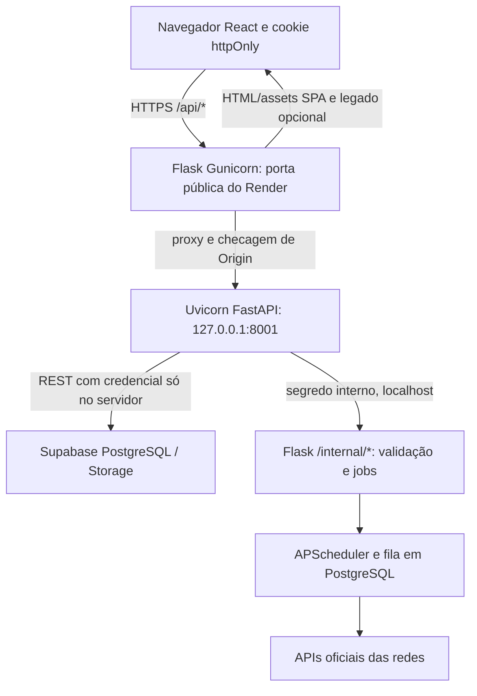

> **03/11/2026 — F4E isolamento de origem em implementação (pré-CI/pré-deploy):** branch de proteção com migration 075 (origem `legacy`/`campaign` positiva, imutável e validada pai-filho) e filtros nas rotas legado/central/recovery/claim/pré-envio. Um trigger no PostgreSQL recusa `running`/chamada externa de campanha mesmo se worker antigo ignorar filtros. Testes PostgreSQL descartável e scheduler adicionados. **Ainda não é ativação de campanhas**; não aplicar migração nem promover main antes de CI, compatibilidade e gates de produto. Sem envio, billing, OAuth ou cambio de VERSION. A nota de hotfix cron abaixo refere-se ao estado histórico pré-merge; a PR #240 já foi homologada em staging.

> **03/11/2026 — Falha real de posts cron em staging, correção em homologação:** logs Render após o deploy F4E-2B4 mostram `publish_queue_recovery` falhando em `claim` com `InvalidDatetimeFormat: 2026-11-03T15`: `split_part(..., ':', 2)` truncava minutos da chave `UUID:YYYY-MM-DDTHH:MM`. Correção focal de extrair os 16 caracteres de timestamp e expirar `pending` mais velho que 1h antes do recovery (sem disparar publicação tardia); regressões em testes de scheduler e PostgreSQL; PR/CI/deploy da correção pendentes neste registro. Scheduler de staging/produção inicia, mas Threads em produção mostrou HTTP 403 Meta code 10 (permissões externas). Não recuperar `unknown` automaticamente. Sem migração, envios, flags, OAuth, `main` ou mudança de `VERSION=3.0.0`.

> **03/11/2026 — F4E-2B4 contrato de segurança (sem ativação):** revisão confirmou que o `main` atual ignora a origem de campanha e pode consumir filas compartilhadas; `environment`/`dispatch_mode` não separam campanha de legado. A próxima implementação exige origem positiva, imutável e persistida em `schedulers`/`publish_jobs`, criação atômica do vínculo e proteção do fluxo completo após rollout de leitores em **ambos** os ambientes. [Plano de gates e reversão](superpowers/plans/2026-11-03-f4e2b4-origem-e-rollout-seguro.md). A proposta SQL B3 **não** está pronta para Supabase: revisar locks de índices, exclusão/LGPD e retry manual. Sem mudança em executor, SQL, `main`, flags, envio, cobrança, SMTP ou direitos durante ciclo pago; `VERSION=3.0.0`. Aprovações pontuais continuam exigidas.

> **03/11/2026 — F4E-2B3 proposta em preparação (não operacional):** revisão da proposta SQL F4E2B2 fora de migrations, com identidade composta/FKs RESTRICT dos pais e locks ordenados. Testes reais em PostgreSQL descartável adicionados à CI; PR/SHA/resultado ainda pendentes neste registro. Não foi integrado guard seletivo: ausência de link não prova post legado e a tabela proposta não existe no Supabase. Sem DDL real, executor, main, flag ou publicação. Pedido de downgrade preserva período pago até current_period_end; cobrança fora de escopo. [Matriz de integração, testes e gates](F4E-2B3-PROPOSTA-IDENTIDADE-PAIS-20261103.md). `VERSION=3.0.0`.

> **03/11/2026 — RETIFICAÇÃO VIGENTE (substitui a pausa imediata do downgrade F4E-2B2):** pedido Premium→Pro ou cancelamento →Free é confirmado/agendado imediatamente, **sem reduzir direitos nem pausar campanhas durante o período quitado**. Mudança efetiva só no vencimento, com cobrança do novo ciclo quando aplicável; no corte Premium→Pro, pausa transacional para escolha de até 2 campanhas/perfil. Compra e upgrade: ativação após pagamento confirmado, podendo demorar algumas horas. Avisos no pedido e T−7 dias. E-mails transacionais/marketing ficam em backlog. **Não implementado em checkout/cobrança.** Regra completa em [política F4, seção 12](PLANOS-F4-POLITICAS-E-FASES-20261103.md#12-transições-de-assinatura-e-comunicação--decisão-corrigida-de-rafa-03112026).

> **03/11/2026 — F4E-2B2 PREPARATÓRIA STAGING LIVE (registro pós-deploy, prevalece sobre notas PRE-DEPLOY):** PR [#234](https://github.com/raffastudioproducoes-cloud/shopee_bot-main/pull/234) squash `0483b7a2912e90a7b93d41d9982b0048674853c0`, [CI #41713751800](https://github.com/raffastudioproducoes-cloud/shopee_bot-main/actions/runs/41713751800) SUCCESS. O filtro do teste SQL F4E-2B2 não estava incluído nessa primeira CI; corrigido na PR [#235](https://github.com/raffastudioproducoes-cloud/shopee_bot-main/pull/235), squash `136302434bc10a3f67cb24ede4a4d0db02cbe226`, [CI #41714645658](https://github.com/raffastudioproducoes-cloud/shopee_bot-main/actions/runs/41714645658) SUCCESS: 15 contratos F4E-1 em PostgreSQL descartável e 3 contratos estáticos F4E-2B2. [CI staging #41714932997](https://github.com/raffastudioproducoes-cloud/shopee_bot-main/actions/runs/41714932997), [smoke HTTP #41714932664](https://github.com/raffastudioproducoes-cloud/shopee_bot-main/actions/runs/41714932664) e [ZAP passivo #41714932408](https://github.com/raffastudioproducoes-cloud/shopee_bot-main/actions/runs/41714932408) SUCCESS; smoke autenticado SKIPPED por ausência de credenciais. Render `dep-dbl4e317lnhs739rukhg` **LIVE** no SHA `1363024`. Supabase read-only: reservas=0, ocorrências=0, tabela proposta de vínculos inexistente. **Só contrato inerte e política documental de downgrade aprovada**; não há guardas de executor conectados, alteração de `main`, migração, reserva executável, publicação ou cobrança; `VERSION=3.0.0`. Ver [escopo F4E-2B2](F4E-2B2-IDENTIDADE-INERTE-20261103.md).\n\n> **03/11/2026 — F4E-2B2 PREPARATÓRIA (PR/CI/deploy ainda não verificados):** Rafa aprovou a política de downgrade Premium→Pro: pausar todas as campanhas existentes até o titular escolher no máximo 2 por perfil; preservar as demais e o histórico, sem ativação automática. Corrigido o contrato de identidade para UUID em scheduler/publish_job (post_id INTEGER); guarda continua sempre recusando. Proposta SQL de vínculo persistente inerte permanece **fora do migrador**, não aplicada ao Supabase. Nenhuma integração ao executor, reserva executável, job ou publicação; `main` intocada, `VERSION=3.0.0`. Exige proteção no claim, retry, recovery, pré-envio e rollout compatível em ambos os ambientes antes da ativação. Ver [F4E-2B2 — identidade inerte](F4E-2B2-IDENTIDADE-INERTE-20261103.md).\n\n> **F4E-2A STAGING LIVE (03/11/2026, substitui nota histórica PRE-DEPLOY):** [PR #231](https://github.com/raffastudioproducoes-cloud/shopee_bot-main/pull/231) integrada somente em `staging` no squash `8e0c6b44f84d4fedb9951ef589369127ecaab407`; [CI #773 SUCCESS](https://github.com/raffastudioproducoes-cloud/shopee_bot-main/actions/runs/41707521280) (API 1.170, scheduler 175 + 1 xfailed, SQL 4, segurança/web 27, build frontend e PostgreSQL 16 isolado). Render `dep-dbl3ov15efls73bmmpd0` LIVE no mesmo SHA. Navegador após deploy: `GET /api/health/ready` = `{"status":"ok"}`; `GET /api/campaigns/drafts/11111111-1111-1111-1111-111111111111/preflight?expected_revision=1` sem sessão = `{"detail":"Não autenticado"}`. Supabase compartilhado: `campaign_reservations_f4e` = 0, `campaign_occurrences_f4e` = 0 após deploy. Preflight permanece exclusivamente leitura e parcial (`reservation_available=false`, `reserved=false`, `activated=false`, `checks_complete=false`), sem jobs, reservas, mídias, redes, migração nova nem postagem. `main` não foi alterada. Próximo gate F4E-2B: proteger caminho central/legado de execução e pré-envio com vínculo imutável fail-closed e flags OFF, mais mídia persistente, cota transacional por rede e conta, `service_role`, OAuth, congelamento T−30 e downgrade. Autorização separada obrigatória para qualquer promoção a `main`, reserva ou teste externo. [Vault PR #43](https://github.com/raffastudioproducoes-cloud/RaffaStudio-Vault/pull/43) documenta os riscos.

> **F4E-2A PRE-DEPLOY (PR #231):** preflight autenticado de leitura parcial para rascunho e revisão, política de plano, cronograma e volume por rede. Retorna `preflight_only`, `checks_complete=false`, `reservation_available=false`, `reserved=false`, `activated=false`; não reserva, não chama RPC, não gera jobs/posts e não prova OAuth, retenção física de mídia ou vaga concorrente. Antes de qualquer reserva/execução: proteger mídia e rascunho contra exclusão concorrente, rever writes diretos service_role e validar guardas de dispatch em ambos ambientes. CI, revisão e deploy ainda não confirmados neste registro; `VERSION=3.0.0`.

> **03/11/2026 — Fechamento operacional F4E-1: integrada em staging e LIVE (atualização posterior ao PR draft).** [PR #229](https://github.com/raffastudioproducoes-cloud/shopee_bot-main/pull/229) squash `24c45b671e416d071c80c1c914eecaf6344db0b9`, [CI #764 SUCCESS](https://github.com/raffastudioproducoes-cloud/shopee_bot-main/actions/runs/41702740725) com PostgreSQL 16. Render `dep-dbl3aibbc2fs738kfllg` LIVE nesse SHA; navegador confirmou `/health` e `/api/health/ready` = `{"status":"ok"}`. A migration `20261103191911` está aplicada ao Supabase compartilhado e a `074_f4e1_inert_campaign_reservations.sql` registrada uma vez em `public.migrations` (boot seguro); reservas e ocorrências 0/0 pós-deploy, RLS ativo sem policies, acesso anon/authenticated negado. **Não há executor F4E, campanhas ativadas, agendamentos/jobs/posts ou cobrança; sem promoção de código a main/produção.** F4E-2, barreiras de dispatch, validação por rede/OAuth/mídia, decisão de downgrade e QA de planos são tarefas futuras sujeitas a nova aprovação. Rafa confirmou em mobile tags, mensagens, criação e separação de perfis; escolha de planos ainda indisponível. `VERSION=3.0.0`. Esta nota de fechamento prevalece sobre qualquer registro histórico abaixo que diga “PR draft”.

> **03/11/2026 — F4E-1: DDL inerte aplicada ao Supabase compartilhado, ainda em PR draft.** Por coordenação de Rafa, a migration Supabase `20261103191911 / 074_f4e1_inert_campaign_reservations` foi aplicada; `public.migrations` recebeu `074_f4e1_inert_campaign_reservations.sql`. A inspeção reportada após a aplicação encontrou zero reservas e ocorrências, RLS ativo sem policies, anon/authenticated sem acesso e service_role com SELECT/RPC, sem DELETE. Draft legado preservado. Não foram criados jobs F4E, executor ou publicações, nem houve merge ou deploy de main/produção. [PR draft #229](https://github.com/raffastudioproducoes-cloud/shopee_bot-main/pull/229); [CI #755](https://github.com/raffastudioproducoes-cloud/shopee_bot-main/actions/runs/41701678290) verificou a proposta anterior. Rafa confirmou em mobile apenas tags, mensagens e perfil; QA visual completo em desktop não foi comprovado, e escolha de plano permanece futura. F4E-2, validação por rede e retenção física de mídia continuam pendentes. VERSION permanece 3.0.0. Esta nota prevalece sobre estados anteriores abaixo.

> **03/11/2026 — F4D **integrada apenas em staging**: [PR #219](https://github.com/raffastudioproducoes-cloud/shopee_bot-main/pull/219) squash `9adbd5a455022acecc580c7daba75bd445a8ec22`, [CI #728](https://github.com/raffastudioproducoes-cloud/shopee_bot-main/actions/runs/41696637695) SUCCESS (API 1.165; frontend 38 contratos + TypeScript/Vite; scheduler 175 + 1 xfailed; SQL 4; segurança/web 27; externo skipped esperado). Render staging `dep-dbl2obp5efls73f9durg` LIVE no mesmo SHA; browser confirmou `/health` e `/api/health/ready` como `{"status":"ok"}`. UI autenticada desktop/mobile ainda não verificada. Nenhuma migration/SQL/ativação/job/post externo, cobrança ou alteração de `main`/produção. `VERSION=3.0.0`.**
>
> **F4E auditada somente leitura: dispatch central de produção pode reivindicar agendamentos com origem staging se a configuração de dispatch estiver habilitada (flag real Render não verificada); separar F4E-1 inerte/transacional de F4E-2 execução protegida e não inserir campanha em `schedulers`/`publish_jobs` antes de guardas simultâneos nos dois ambientes. Não houve DDL nem autorização de ativação.**

> **03/11/2026 — F4D em PR, ainda sem merge/deploy:** interface de plano canônico da conta, badges Free/Pro/Premium/Administrador e consumo exato de produtos/conta, listas/perfil e perfis/conta via `GET /profiles/usage` autenticado/read-only. Conta/papel e limites são relidos no servidor; `profiles.plan_tier` não decide assinatura. Consumo de Agora/recorrência permanece indisponível (`null`), não zero fictício. Campanha respeita caps do servidor (Pro 15/3, Premium 30/15, ADMIN limites físicos), Free não cria/edita/upload/prévia, preservando leitura/exclusão do legado. Automação é vitrine, mesmo Premium/ADMIN: direito não significa executor. CTA informacional, sem preços, checkout ou alteração de plano. Nenhuma migration/SQL, scheduler, ativação, job, postagem ou mudança de main. `VERSION=3.0.0`. CI/QA/deploy não confirmados nesta nota. Ver [contrato F4, seção 10](PLANOS-F4-POLITICAS-E-FASES-20261103.md#10-f4d--interface-de-plano-consumo-e-acesso).

> **03/11/2026 — F4C2 guardas de campanha integradas em staging (evidência pós-merge):** [PR #217](https://github.com/raffastudioproducoes-cloud/shopee_bot-main/pull/217) squash-merge **somente staging** SHA `d80f60d289c314064fa6ac728c4b23f898a767c2`, [CI #722](https://github.com/raffastudioproducoes-cloud/shopee_bot-main/actions/runs/41692608479) SUCCESS (API 1.157, scheduler 175 + 1 xfailed, SQL 4, web 27, frontend/build aprovados). Render staging `dep-dbl2d1k9v7es73datmag` LIVE no SHA; navegador confirmou `/health` e `/api/health/ready` = `{"status":"ok"}`. Free bloqueado para novas campanhas; Pro até 15 dias e 3 unidades de rede/dia, Premium até 30 dias e 15; ADMIN bypass comercial com ownership e segurança. **F4C2 é preparatória:** não há ativação nem automação operacional; 2/5 campanhas ativas exigem reserva atômica F4E. Nenhuma migration 074/SQL, postagem ou alteração de `main`/produção. `VERSION=3.0.0` inalterada. QA de usuário autenticado e concorrência real ainda pendentes. Esta nota prevalece sobre fotografias pré-merge abaixo.

> **03/11/2026 — F4C2, histórico da preparação pré-merge:** campanhas Free bloqueadas nas entradas de prévia/criação/edição/upload; Pro até 15 dias inclusivos e 3 publicações/dia, Premium até 30 dias e 15/dia; cada rede conta uma unidade no rascunho com planejamento. ADMIN ignora cotas comerciais, não segurança/ownership nem teto absoluto de 30 dias. Política de conta e limites auditados são relidos no servidor sem cache. Leitura/exclusão de rascunho legado permanecem disponíveis após downgrade. Não há ativação nem automação operacional: limite de 2/5 campanhas ativas ainda depende de reserva transacional na F4E; consumo retorna `null`, nunca zero fictício. Sem migration 074 nem mutação de banco. Ver [contrato F4](PLANOS-F4-POLITICAS-E-FASES-20261103.md), seção 8.

> **03/11/2026 — F4C1 concluída em staging:** PR #215 squash-merge apenas em staging SHA `397f0f760570c7aa39a1756f6a9e05deaf205d2f`, CI #717 verde, migration 073 autorizada e aplicada (Supabase `20261103175106`, `public.migrations` id=68), Render `dep-dbl20fss728c739c6kag` LIVE, `/health` e `/api/health/ready` = `{"status":"ok"}`. Sem post externo nem promoção `main`/produção; `VERSION=3.0.0`. Cotas por perfil/rede em Agora (Free1/Pro3/Premium5 por hora), cron (Free1/Pro5/Premium5 slots/dia); ADMIN sem teto comercial. Banco com RLS/grants, RPC só service_role. Vault PR #38 mesclada. UI autenticada e postagem real não testadas. Ver [matriz F4](PLANOS-F4-POLITICAS-E-FASES-20261103.md).

> **Decisão confirmada F4B2 em 03/11/2026:** perfil principal obrigatório. Free = 1 perfil total (nenhum adicional); Pro = 3 totais (1+2); Premium = **5 totais** (1+4); ADMIN sem limite comercial. Compartilhados na conta: produtos, Shopee, IA/Gemini. **Isolados por perfil: listas (Rafa confirmou manter), social OAuth, posts criados/agendados/publicados/recorrentes, histórico, campanhas e mídias.** Aplicação gradual no staging: RPC de perfil respeita limites e trigger legado segura `main` em três perfis até release próprio. Ver [contrato F4](PLANOS-F4-POLITICAS-E-FASES-20261103.md). Status não equivale a DB aprovado/deploy concluído.

> **03/11/2026 — F4 política de planos (staging, rollout em fases):** Rafa confirmou **Free, Pro, Premium** e exceção comercial **ADMIN**. Matriz, escopo conta/perfil, acesso bloqueado com CTA, lacunas Premium e gates estão em [PLANOS-F4-POLITICAS-E-FASES-20261103.md](PLANOS-F4-POLITICAS-E-FASES-20261103.md). `Plus` permanece alias legado até migração; UI de rótulos Pro/Administrador é F4A, **não** prova enforcement de cotas. Conta de suporte/teste `RafaelTesteCliente` alterada pontualmente para `premium` no perfil principal, com leitura posterior; `rafastudio` permanece ADMIN com tag histórica Free. Nenhum post disparado, `main` intacta.

> **02/11/2026 — Correção de isolamento entre os schedulers de staging e main (implantação em etapas):** o mesmo Supabase permanece, mas agendas novas terão `schedulers.environment` conforme o branch Render; jobs anteriores ficam na produção. APScheduler passa a usar `apscheduler_jobs` em main e `apscheduler_jobs_staging` em staging; recuperação/claims da fila verificam o ambiente e dono. Ativação de staging só depois de a main receber estes filtros. Detalhes, verificação e rollout em [SCHEDULER-ENVIRONMENTS-20261102.md](SCHEDULER-ENVIRONMENTS-20261102.md). Nenhuma publicação externa é validada por CI.\n\n> **02/11/2026 — Identidade e concorrência de posts (somente staging; aguardando CI/PR):** `posts.id` numérico já é único e crescente (mesmo após exclusão), agora exposto como `#ID` na lista e nos detalhes. O agrupamento visual usa apenas `group_id` explícito; fluxo “Agora” separa criação confirmada de disparo não confirmado; fila e leituras exigem correspondência entre usuário, perfil, post e agenda. Auditoria do banco compartilhado em leitura encontrou zero vínculos cruzados na amostra existente. **Scheduler de staging continua desligado** para não executar agendas da produção no Supabase compartilhado. Detalhes, limites e QA em [POSTS-IDENTIDADE-CONCORRENCIA-20261102.md](POSTS-IDENTIDADE-CONCORRENCIA-20261102.md). Não alterar `main`/produção.

> **02/11/2026 — IA de textos por rede, em revisão (somente staging, PR #186):** o gerador agora pede **uma descrição individual para cada rede selecionada**, com uma chamada estruturada de IA, retry seletivo e adaptação determinística final caso ainda exceda caracteres/hashtags/menções. O link de afiliado permanece completo; variantes ajustadas são sinalizadas para revisão antes da publicação. O planejador de mídia existente preserva a seleção compatível por rede; a interface distingue subconjunto enviado, publicação sem mídia e rede excluída. Nenhum post real foi publicado como teste. Implementação, limites e QA em [POSTS-COPY-IA-POR-REDE-20261102.md](POSTS-COPY-IA-POR-REDE-20261102.md) e [PR #186](https://github.com/raffastudioproducoes-cloud/shopee_bot-main/pull/186). **Não promover à main/produção.**

> **Complemento de 02/11/2026 — staging após PR #181:** CI #521 verde; Render deploy `dep-dbk0blfavr4c73cj0srg` de `4ffc0f7` live, health `{"status":"ok"}`. Correção histórica do 403 está em PR complementar: somente 4xx na criação do primeiro contêiner, zero partes publicadas e correspondência de scheduler/tempo é considerado “Erro”; demais casos seguem incertos. Sem publicação real de teste nem promoção à produção. Veja `docs/POSTS-AJUSTES-RECORRENCIA-20261102.md`.

> **02/11/2026 — Correção dos posts em desenvolvimento (staging, ainda não publicada):** seleção de um produto, retirada de agendamento avulso, seletor desktop em 24h, histórico do estado de cada ocorrência, última postagem confirmada e erro simplificado para usuário. Supabase compartilhado impede apagar esquema/legado; erro HTTP 403 do Threads precisa de código Meta e autorização antes de declarar publicação funcionando. Detalhes e QA: [POSTS-AJUSTES-RECORRENCIA-20261102.md](POSTS-AJUSTES-RECORRENCIA-20261102.md). **Não alterar main/produção.**

> **Correção de login temporário para suporte Shopee — PR #166, 01/11/2026, staging.** Rafa confirmou os fluxos de navegação anônima, Google e prévia da landing, mas relatou que `RafaelTesteCliente` era rejeitado no formulário por `type=email` antes de chegar ao backend. O formulário unifica e-mail ou nome de usuário, faz roteamento explícito por tipo de identificador (e-mail → Supabase Auth; usuário autorizado → endpoint legado), preserva fallback de ambiente sem Supabase e mantém backend com whitelist `SUPABASE_LEGACY_SUPPORT_USERNAME` e papel USER. Sem modificação de senhas, contas ou chaves. Implementação no [PR #166](https://github.com/raffastudioproducoes-cloud/shopee_bot-main/pull/166), CI e smoke reais ainda pendentes. Produção não autorizada. Ver `docs/TASK.md` e [Vault TASK](https://github.com/raffastudioproducoes-cloud/RaffaStudio-Vault/blob/main/Projetos/ShopeeAutoVendas/TASK.md).

> **Fase 2 landing — somente em homologação (`staging`), 01/11/2026:** Rafa aprovou prosseguir após aceitar o protótipo desktop/mobile. [PR #165](https://github.com/raffastudioproducoes-cloud/shopee_bot-main/pull/165) muda a raiz `/` para entrada com landing anônima e redirecionamento após sessão **confirmada pelo backend**: USER → `/app`, ADMIN → `/admin/overview` (exceto escolha explícita do ADMIN por visitar `/app`). Link compartilhável `/presentation` sempre exibe landing, mesmo logado; `/apresentacao` vira alias. As rotas `/login`, `/admin/*`, Google/Supabase OAuth, e o login temporário da conta de suporte Shopee permanecem preservados. Metadados Open Graph/Twitter no HTML inicial fornecem imagem e descrição, **sem canonical ou og:url fixos de produção**, para não trocar links compartilhados do staging pelo domínio de produção. O Flask envia `X-Robots-Tag: noindex, nofollow` para HTML no host de staging antes da execução de JavaScript. Não mudou API, banco, controle de permissão nem design/copy aprovado. Contratos TDD e frontend build passaram inicialmente no [CI #464](https://github.com/raffastudioproducoes-cloud/shopee_bot-main/actions/runs/41340196960); após a revisão independente foram adicionados testes para host de compartilhamento e noindex (RED específico no [CI 41340727402](https://github.com/raffastudioproducoes-cloud/shopee_bot-main/actions/runs/41340727402)). CI final, deploy e smoke autenticado ainda exigem evidência posterior. **Não promover à produção sem nova autorização de Rafa.** Ler [especificação](superpowers/specs/2026-11-01-landing-entrypoint-routing-design.md), [plano](superpowers/plans/2026-11-01-landing-entrypoint-routing.md), [TASK.md](TASK.md) e Vault documento 34.

> **Alteração em homologação — 01/11/2026 (Posts):** Rafa determinou que o histórico em `/posts` tenha cards curtos com texto resumido, produtos, redes, criação, tipo de publicação, última execução, data/hora programada e dias/horas de recorrência. A busca deve filtrar enquanto se digita por texto/produto/rede/data/hora, inclusive além da primeira página. O clique em um post existente é **consulta**, não edição: modal separado com textos completos, produtos, mídia, redes, programação, recorrência e resultados, sem seletores nem ações de edição/IA. Proteger também `PUT /posts/{id}` e mutations de mídia contra alteração de posts programados, recorrentes, enviados ou tentados. O comando de **Novo post** permanece editável; preservar conciliação de envio incerto. A mudança está na branch `fix/posts-resumo-busca-detalhes-readonly-2026-11-01` e só deve ser considerada entregue após testes/CI/staging e autorização de promoção para `main`. Não publicar posts reais nem alterar o Supabase compartilhado para testá-la. Ver `docs/TASK.md`.

# Auto Orbital — Guia Mestre de Contexto para IAs e Mantenedores

## Estado vigente — Supabase Auth publicado em produção (01/11/2026, 05:13 UTC)

- **Código/release:** PR [#155](https://github.com/raffastudioproducoes-cloud/shopee_bot-main/pull/155) integrado em `main` SHA `a6b87b3228db2164601225652d95b5bbbc38184c`; CI [#437](https://github.com/raffastudioproducoes-cloud/shopee_bot-main/actions/runs/41275819236) **success** (API, frontend e smoke de staging). PR #154 criou coexistência de login e PR #156 adequou o smoke; staging `1738c146`, deploy `dep-dbjcgjou01pc73f2scng` live.
- **Render produção:** serviço `shopee-bot`, deploy `dep-dbjckhrbc2fs73cegte0` **live** após configuração. `SUPABASE_AUTH_ENABLED=true`; chave **publicável** do projeto correto configurada sem exposição; `SUPABASE_AUTH_REDIRECT_BASE_URL=https://shopee-bot-fj0w.onrender.com`; `SUPABASE_LEGACY_SUPPORT_USERNAME=RafaelTesteCliente`; `SUPABASE_AUTH_EMAIL_SIGNUP_ENABLED=false` (sem SMTP próprio para público).
- **Smoke anônimo de produção:** `/login` 200, `/api/health/ready` 200, `/api/auth/supabase/config` 200 (`email_enabled=true`, `google_enabled=true`, `email_signup_enabled=false`, `legacy_support_enabled=true`), `/api/auth/supabase/google/authorize` 302; tentativa artificial com username inexistente no login legado retorna 410. Logs recentes sem novo erro de aplicação após deploy (somente SIGTERM normal do worker na troca).
- **Conta de suporte Shopee preservada:** `RafaelTesteCliente` continua USER, sem e-mail/Google, validada no backend Render contra hash existente em `public.users` Supabase; bypass legado **apenas** para esse username autorizado, com bcrypt/rate limit. Nenhuma senha, vínculo ou dado foi alterado; não remover nem excluir automaticamente.
- **Pendências explícitas:** Rafa precisa confirmar um **novo login Google completo em produção** até `rafastudio` ADMIN; o smoke 302 não prova callback/sessão real. Não foi usada senha verdadeira do suporte, portanto login E2E dele também não foi repetido. Recuperação de senha por link implementada, mas entrega real de e-mail não homologada. **Cadastro público por e-mail permanece desligado** até configuração/validação SMTP após domínio próprio. JWT interno de até 24h ainda é ponte transitória e requer plano futuro de revogação/migração.

> **LEITURA OBRIGATÓRIA ANTES DE ALTERAR O PROJETO.** Versão documental: 01/11/2026 (adendo de governança/SMTP, sem mudança operacional). Produto anteriormente denominado **Shopee Auto Vendas**; o nome de marca atual é **Auto Orbital**. Este guia é um mapa de entrada operacional, não substitui código, migrações ou evidência de ambiente. **Não contém segredos.**
>
> **Regra de precisão:** [IMPLEMENTADO] = observado no código/migração; [OPERACIONAL] = confirmado também em serviço/configuração; [CONDICIONAL] = depende de configuração, OAuth ou plataforma; [PLANEJADO] = documento ou código isolado sem entrega ao usuário; [NÃO OFERECIDO] = indisponível ou expressamente excluído. Uma feature existir no repositório **não prova** uma publicação externa bem-sucedida.

## 0. Identidade, localização e ordem obrigatória de leitura

- **Produto:** Auto Orbital; software proprietário da **Raffa Studio Produções**, responsável Rafa. Nome histórico de pasta/repositório: *ShopeeAutoVendas* e *shopee_bot*. Não renomear paths técnicos só porque a marca mudou.
- **Código principal (fonte do comportamento):** https://github.com/raffastudioproducoes-cloud/shopee_bot-main — branches `staging` (homologação) e `main` (produção).
- **Documentação de decisões e histórico:** https://github.com/raffastudioproducoes-cloud/RaffaStudio-Vault/tree/main/Projetos/ShopeeAutoVendas — pasta **Projetos/ShopeeAutoVendas/**. Pode estar sincronizada localmente com Obsidian, mas **não presumir** um caminho absoluto de disco em outro ambiente.
- **Este documento canônico versionado com código:** `docs/GUIA-MESTRE-IA.md`. **Espelho para consulta no Vault:** `40-Guia-Mestre-IA-Auto-Orbital.md` na pasta acima. Atualizar os dois no mesmo trabalho, quando mudarem regras/fluxos.
- **Entrada automática de agentes:** `AGENTS.md` na raiz do repositório. A primeira tarefa de qualquer IA é ler esse arquivo, este guia e os docs relevantes à alteração.

**Ordem mínima para qualquer IA:**
1. `AGENTS.md` → este guia → `docs/RULES.md` → `docs/PRD.md`.
2. Para funcionalidade: `docs/ARCHITECTURE.md`, módulos de código citados na seção 5 e `docs/DESIGN.md` para UI.
3. Para estado atual e aprovação: Vault `39-Estado-Operacional-e-Seguranca-2026-10-31.md` e `TASK.md`. Histórico mais antigo pode conter status superados.
4. Para deploy/segurança/banco: `SECURITY.md`, `docs/SEGURANCA-PENDENCIAS-20261031.md`, `docs/ADMIN-METRICS.md` e migrações; verificar o ambiente atual.
5. Antes de editar, identificar branch, SHA, mudanças não commitadas, dependências, risco a dados e testes específicos. Nunca usar uma captura histórica como verdade presente.

**Regra operacional de leitura antes e depois (Rafa, 01/11/2026):** antes de cada tarefa, a IA deve ler `AGENTS.md` no projeto, este Guia, os documentos específicos e o `TASK.md` vivo no Vault. **Após criar/alterar qualquer documentação**, deve reabrir a versão persistida, verificar a coerência entre projeto e Vault, atualizar links/referências pertinentes e **reconsultar as tarefas condicionais do Vault**. Se não conseguir acessar alguma fonte, declarar a limitação em vez de assumir que está atualizada.

**Alerta condicionado a domínio próprio — SMTP:** [PENDENTE] Rafa decidiu manter temporariamente o **SMTP padrão do Supabase**, sem contratar domínio/serviço nem configurar SMTP externo agora. Se o site Auto Orbital passar a ter **domínio próprio registrado e configurado** e esse fato estiver documentado em qualquer fonte viva do Vault **ou** do projeto, a IA que identificar a evidência **na leitura inicial ou após atualizar documentos** deve **avisar Rafa na mesma sessão** e perguntar se deseja retomar a integração SMTP para e-mails de confirmação de clientes. **Não** executar compra, alteração de DNS/SMTP, OAuth ou cadastro público automaticamente. Detalhe e checklist em [Vault TASK.md](https://github.com/raffastudioproducoes-cloud/RaffaStudio-Vault/blob/main/Projetos/ShopeeAutoVendas/TASK.md). Não existe monitoramento automático fora de sessões ativas de agentes.

**Precedência se houver divergência:** código **implantado** + schema/permissões reais + deploy/CI; depois decisões expressas de Rafa; depois documentos vivos com data; por último planos/relatos antigos. Para comportamentos externos, a resposta da API oficial e suas permissões prevalecem sobre inferência local. Registrar a divergência ao corrigi-la.

## 1. Por que existe, para quem e como deve ficar pronto

O Auto Orbital visa reduzir o trabalho repetitivo de quem faz marketing de afiliados: **buscar produtos elegíveis, organizar ofertas, criar mensagens de divulgação, montar mídias apropriadas, conectar redes sociais, agendar/publicar e consultar resultados operacionais** em um só lugar. A referência de catálogo inicial é a **Shopee Affiliate Open API**. Não é loja que vende/entrega produtos, processador de pagamentos de compras ou garantia de vendas/comissões.

**Público:** criadores de conteúdo, afiliados, pequenos negócios e operadores que divulgam produtos em perfis próprios. Administração é separada dos clientes. Cada conta pode ter **até três perfis**; o perfil principal é protegido. O cadastro comum recebe **USER**; operações globais e diagnósticos sensíveis são **ADMIN**. O público futuro não deve precisar conhecer Client ID/Client Secret de aplicativos sociais: deverá conectar contas por OAuth consentido, exceto credenciais próprias de afiliado Shopee e chave opcional de provedor de IA.

**Experiência-alvo quando estiver madura:** interface PT-BR acessível, responsiva e coerente com o design system; onboarding e consentimentos claros; conexão OAuth explicada; resultados de cada rede sem promessas falsas; mídia segura e custos previsíveis; filas recuperáveis, estados de publicação confiáveis; privacidade/LGPD; planos e cobrança **somente quando formalizados e implementados**; operação escalável sem permitir vazamento entre contas/perfis. Estado-alvo não significa que todos estes itens estão prontos hoje.

**Regras permanentes do proprietário:**
- Priorizar **Render Free** e **Supabase Free**. Nenhum serviço pago, upgrade automático, Redis adicional, migração de infraestrutura ou cobrança sem autorização explícita de Rafa. Otimizar, limitar e documentar antes de gastar.
- Imagens e vídeos de posts ficam em **Supabase Storage**, não em Cloudinary; o Cloudinary foi removido nos PRs #119/#120.
- **Não implementar cota acumulada de imagens por usuário/perfil** até nova decisão. Existe apenas a capacidade **global** de Storage, com alertas 75%/85% e bloqueio preventivo 90%.
- **Shopee Vídeo** não está integrado à UI/publicação: requer aprovação oficial da Shopee Open Platform; o cliente isolado em `apis/shopee_video.py` não autoriza tratá-lo como ativo.
- Não executar pentest externo independente, contratar infraestrutura adicional nem alterar o procedimento de digest OCI sem nova autorização. Não pedir que Rafa cole credenciais; usar apenas sessões/conexões legitimamente disponíveis e necessárias, sempre dentro do escopo autorizado.
- Manter documentação viva, design/layout existente e segurança; trabalhar em branch → `staging` com testes → `main` só após validação. **Não publicar posts reais, reautorizar OAuth ou alterar dados de terceiros automaticamente só para provar que algo funciona.** Validar o tipo de teste e o destino permitido.

## 2. O que o produto entrega e o que NÃO entrega

| Área | Situação e contrato real | Código primário |
|---|---|---|
| Cadastro/login/sessão e troca de senha | [OPERACIONAL] Supabase Auth Google/e-mail habilitado em produção; recuperação por link implementada, mas entrega de e-mail externo não homologada; cadastro público por e-mail temporariamente desligado. Exceção USER `RafaelTesteCliente` permanece usuário/senha bcrypt; JWT próprio ainda é ponte transitória. | `api/routers/supabase_auth.py`, `api/routers/auth.py`, `api/routers/settings.py` |
| Conta, planos e perfis | [IMPLEMENTADO] ADMIN/USER, até 3 perfis, perfil ativo, edição, exclusão, avatar, backup/restauração com checksum, autoexclusão. Rótulos Free/Plus/Premium **não comprovam cobrança**. | `api/routers/users.py`, `api/routers/profiles.py`, `api/profiles.py` |
| Produtos e listas | [IMPLEMENTADO] CRUD por conta/perfil; busca remota no catálogo Shopee e categorias, com limite de chamadas. Comissão/estoque/resposta dependem da API oficial. | `api/routers/products.py`, `catalog.py`, `lists.py`, `api/shopee_catalog.py` |
| Copy com IA | [CONDICIONAL] Gerador de textos por persona usando **chave do próprio usuário** para Gemini/OpenAI/Anthropic; sujeito a modelo, autorização, preço e quota do provedor do usuário. | `api/routers/posts.py`, `apis/llm.py` |
| Posts e agendamento | [IMPLEMENTADO] Composição por rede, prévia, lote, rascunho de mídia, publicação imediata/agendada/recorrente, histórico e conciliação. Êxito de código/CI **não comprova** publicação em cada conta real. | `api/routers/posts.py`, `scheduler/`, `database/publish_jobs.py` |
| Redes sociais | [CONDICIONAL] OAuth/consentimento, tokens próprios e publicadores para Threads, Facebook, Instagram, TikTok e X; cada plataforma impõe escopos/revisão/limitações. **X está desabilitado para publicação no produto** pela regra atual, mesmo existindo implementação. | `api/routers/credentials.py`, `api/*_oauth.py`, `apis/`, `scheduler/bot_post*.py` |
| TikTok | [CONDICIONAL] Caminho de publicação **somente vídeo**; fotos e texto puro não são entregues pela implementação atual; restrições da API e modo de privacidade devem ser verificadas. | `api/network_limits.py`, `apis/tiktok.py` |
| Kwai | [NÃO OFERECIDO] Não há API pública de postagem integrada. O módulo é *placeholder* que lança `NotImplementedError`; não fingir publicação. | `apis/kwai.py` |
| Shopee Vídeo | [PLANEJADO/BLOQUEADO] Cliente técnico isolado sem fluxo de usuário autorizado; não confundir com Shopee Affiliate GraphQL. | `apis/shopee_video.py`, `docs/SHOPEE-VIDEO-VALIDACAO.md` |
| Métricas de redes | [PARCIAL] Painéis KPI e gráficos (evolução real diária de `publish_jobs` via RPC invoker service_role, distribuição por rede, situação dos envios e estado dos insights), mantendo tabela e filtros; contagens operacionais de jobs por conta/perfil; botão **Atualizar informações** disponível para USER/ADMIN, coleta periódica de insights com cache/claim por perfil (24h, 5min manual), e sondas técnicas separadas **somente ADMIN**. Métricas só aparecem quando fornecidas/validadas pela API (Facebook Página; Threads/Instagram não confundem métricas/períodos); TikTok/X sem leitor habilitado. Nenhuma conversão ou lucro inferido. | `api/routers/social_analytics.py`, `api/analytics_refresh.py`, `database/migrations/064_analytics_daily_refresh.sql`, `database/migrations/065_analytics_daily_job_counts.sql`, `frontend/src/components/AnalyticsVisuals.tsx`, `docs/ANALISE-REDES-PLANO.md` |
| ADMIN operacional | [IMPLEMENTADO] Visão geral, usuários, logs sanitizados, status de credenciais, consumo e capacidade, fila e métricas. Fontes ausentes aparecem como indisponíveis, não como zero. | `api/routers/admin.py`, `api/admin_metrics.py`, `frontend/src/pages/AdminOverviewPage.tsx` |
| Landing comercial, cobrança real e escala multi-instância | [PLANEJADO/PARCIAL] Existe roadmap; páginas de termos/privacidade são reais, mas **planos pagos, checkout e promessas de cobertura total** não devem ser anunciados sem implementação e aprovação. | `docs/ROADMAP-MVP.md`, Vault documentos 34/35 |

A tela de credenciais deve mostrar status de conexão, **nunca** devolver tokens salvos. Verde na conexão indica um teste/estado daquele momento, **não** que publicar ou ler insights esteja autorizado em qualquer data. Não inferir métricas ausentes como zero.

## 3. Topologia vigente, ambientes e tecnologia

**Stack real:** React 19 + TypeScript/Vite 6, Zustand, TanStack Router/Query e tokens CSS próprios; Flask/Jinja2 legado; FastAPI/Starlette/Pydantic; Python 3.13, Gunicorn/gevent + Uvicorn; APScheduler + PostgreSQL/psycopg; Supabase PostgreSQL + REST via supabase-py + Storage; Pillow/FFmpeg para mídia; Docker multi-stage com Node 22 para build. As versões exatas ficam nos arquivos de dependência e lockfiles, não nesta fotografia.

**Caminho da requisição do navegador:**

- **Render produção:** serviço `shopee-bot` (`srv-da6vrla6iojc7380a13g`), branch `main`, região Virginia, Docker, plano **free**, uma instância; URL https://shopee-bot-fj0w.onrender.com.
- **Render staging:** serviço `shopee-bot-staging` (`srv-daukgs17lnhs738tpl50`), branch `staging`, região Oregon, Docker, plano **free**, uma instância; URL https://shopee-bot-staging.onrender.com.
- **Supabase:** projeto `wcentenooirmwwlwlljp`, **compartilhado** entre staging e main. Ambas acessam os mesmos dados, objetos e cotas; teste destrutivo na staging **pode atingir produção**. O nome de exibição do projeto é histórico; usar o ID para evitar confusão. Não duplicar credenciais em docs.
- **Key Value Render:** uma instância Free de staging, `auto-orbital-staging-ratelimit` (Oregon), observada em 31/10; **não** foi constatada instância equivalente na produção. Presença de serviço não prova que a URI esteja configurada no app. Ver seção 8.
- **Deploy confirmado no fechamento anterior (31/10):** staging `17882e7`, main `edcca08`, ambos Render `live`, CI main concluída. Esta é uma fotografia e deve ser renovada antes de nova promoção.

**Startup:** `Dockerfile` compila React e copia `frontend/dist` para imagem Python sem Node; roda como usuário sem root e utiliza `tini`. `gunicorn.conf.py` expõe `0.0.0.0:$PORT`, com um worker gevent. Um Uvicorn independente inicia em localhost:8001; o supervisor reinicia falhas do subprocesso sem confundir o código de saída com falha do worker principal. O hook do Flask inicializa banco e, se habilitado, scheduler in-process. `LEGACY_PANEL_ENABLED=true` reativa Jinja (rollback), por padrão React é o painel. `/health` verifica o processo; `/api/health/ready` consulta Supabase com timeout e não equivale ao health superficial.

**Conexões não são intercambiáveis:** `SUPABASE_URL`/`SUPABASE_KEY` são do backend (papel privilegiado de serviço, não expor ao React); variáveis `SHOPEE_PG_...` servem ao acesso PostgreSQL do scheduler/legado; `API_SECRET_KEY` assina cookies JWT e estados; `APP_ENCRYPTION_KEY` cifra tokens externos; `INTERNAL_API_SECRET` protege o bridge Flask; `CORS_ORIGINS` restringe origens; `RATELIMIT_STORAGE_URI` ativa contadores distribuídos somente quando configurada. Nunca registrar **valores** de env vars em documentação, PR ou logs.

## 4. Mapa de módulos — onde uma IA deve mexer e o que NÃO assumir

| Domínio | Implementação e responsabilidade | Limite/integração |
|---|---|---|
| SPA/navegação | `frontend/src/router.tsx` roteia cliente, legal e `/admin`; `frontend/src/pages/` apresenta páginas; `frontend/src/lib/api.ts` faz fetch same-origin com cookie. | Guard visual não substitui autorização do backend. |
| Design system | `frontend/src/styles/tokens/`, `frontend/src/components/ui/`, `frontend/src/styles/admin.css`. | Preservar paleta/tipografia/escala, acessibilidade, mobile e comportamento de erro/carregamento. |
| Flask borda | `web/__init__.py` segurança de resposta, sessão legada, CSRF, SPA e hooks; `web/routes/api_proxy.py` repassa corpo e status ao FastAPI. | Proxy verifica Origin de mutações com cookie; upstream timeout 30s e corpo limitado por Flask. |
| Bridge privado | `web/routes/internal.py` valida segredos e lista funções autorizadas; `api/internal_client.py` chama por HTTP local com segredo. | Nunca expor `/internal/*` sem HMAC/secret/whitelist, nem aceitar função arbitrária. |
| Autenticação | `api/routers/auth.py` login, registro USER, logout, senha e JWT; `api/routers/settings.py` muda senha. | Cookie httpOnly+Secure+SameSite Lax, jti revogado e versão do hash; não há recuperação por e-mail. |
| Perfil e autorização | `api/routers/profiles.py` e `api/profiles.py` resolvem perfil ativo e aplicam `scope_owner` (`user_id+profile_id`) ou `scope_account` (`user_id`). | Recurso de conta compartilhado não deve herdar escopo de perfil por engano. |
| Usuários/backup/LGPD | `api/routers/users.py` administração, autoexclusão, export e restore com checksum; `api/routers/meta_callbacks.py` recebe desautorização e exclusão Meta/Threads. | Testar ownership, idempotência, revogação de sessão e minimização de dados. |
| Catálogo Shopee | `api/shopee_catalog.py` + `api/routers/catalog.py` consultam Affiliate GraphQL via HTTPS/assinatura SHA256; `apis/shopee.py` suporta legado. | Busca tenta campos ricos e recua aos mínimos quando schema os rejeita; nunca confundir com Shopee Video. |
| Produtos e listas | `api/routers/products.py`, `lists.py`, `database/products.py`, `product_lists*.py`. | Validar ownership de IDs de produtos e lists; não permitir mistura de contas. |
| Credenciais/OAuth | `api/routers/credentials.py`, `api/{threads,instagram,facebook,tiktok,x}_oauth.py`; `api/crypto.py`. | Salva token cifrado por conta/perfil; diagnóstico bruto é ADMIN; OAuth exige state/cookie; app único não significa token global de cliente. |
| Publicação/mídia | `api/routers/posts.py`, `api/network_limits.py`, `api/media_composition.py`, `api/media_sanitizer.py`, `api/video_processor.py`. | Validação backend obrigatória mesmo quando frontend valida; adaptar/rejeitar mídia conforme rede. |
| Storage/cota | `api/storage_capacity.py`, migrações `058`/`059`, `scheduler/media_delivery.py`. | Reserva global no PostgreSQL, bucket privado, URLs temporárias; sem quota acumulada individual. |
| Scheduler | `scheduler/__init__.py`, `scheduler/bot_post*.py`, `database/publication_claims.py`, `database/publish_jobs.py`. | Lease e idempotency key para evitar duplicação; status desconhecido exige conciliação, não retry cego. |
| APIs externas | `apis/{threads,facebook,instagram,tiktok,x,kwai,shopee,llm,shopee_video}.py`. | Cada API tem contrato diferente; Kwai é stub, Shopee Vídeo isolado, X bloqueado pela regra do produto. |
| ADMIN | `api/routers/admin.py`, `api/admin_metrics.py`, `api/admin_queue_health.py`, `api/admin_operations.py`, `frontend/src/components/admin/`. | Todos os endpoints ADMIN dependem de verificação server-side de papel; exibir agregado, indisponível e idade da amostra. |
| Insights/atividades | `api/routers/social_analytics.py`, `notifications.py`, `logs.py`, `api/middleware.py`. | Diferenciar contagem interna de insights oficiais; log bruto pode guardar IP, projeção de ADMIN minimiza. |
| Banco e migrations | `database/`, `database/migrations/`, `database/migrations/__init__.py`. | Supabase SDK e psycopg coexistem; scripts podem ser aplicados no startup. Não duplicar migration já aplicada. |
| CI/CD/SBOM | `.github/workflows/{ci,cd,cd-staging,sbom,staging-security-smoke,staging-zap-baseline}.yml`, `scripts/staging_security_smoke.py`. | CI verde não substitui deploy live, OAuth/publicação real nem pentest. |

## 5. Fluxos de integração e tratamento de ponta a ponta

### 5.1 Browser → backend → banco

1. React usa `frontend/src/lib/api.ts` para `/api/<rota>` na mesma origem; `credentials: include` transmite cookie sem colocar token em JavaScript. Multipart envia `FormData`, permitindo ao browser definir boundary.
2. O Flask recebe HTTPS pelo proxy do Render, aplica tamanho máximo, rate limit, cabeçalhos e verificação de Origin para POST/PUT/PATCH/DELETE autenticados por cookie; remove headers hop-by-hop e substitui X-Forwarded-For pelo IP apurado pela borda.
3. Uvicorn executa o router FastAPI, valida Pydantic, autentica usuário, resolve perfil, aplica escopo de conta/perfil e faz consulta no Supabase. A aplicação **não usa RLS por usuário do JWT do Supabase** para as operações correntes; utiliza service role no servidor e filtragem explícita da aplicação — cuidado especial com IDOR.
4. Retorno HTTP é repassado ao browser. Códigos recorrentes: 400/422 entrada inválida; 401 sessão ausente/expirada; 403 sem papel/escopo; 404 recurso não pertencente; 429 limite; 502 API upstream indisponível; 503 proteção/capacidade indisponível; 507 capacidade global de Storage atingida. O frontend formata erros em PT-BR.
5. Logs HTTP opcionais em `request_logs` ajudam a reproduzir falhas; `X-Request-ID` permite correlação. Cuidado: histórico bruto pode registrar IP, username e caminho; não exportar a tabela como se fosse dado anônimo.

### 5.2 Shopee Affiliate: busca, consulta e link

1. O perfil/conta possui `shopee_credentials`, App ID + segredo próprios de afiliado, cifrados no banco; o backend os decifra somente para chamar a API.
2. `GET /api/products/catalog-search` e `/catalog-categories` consultam a Affiliate Open API com `Authorization: SHA256 Credential=..., Timestamp=..., Signature=...` sobre o payload GraphQL; não enviar assinatura ao browser.
3. A busca aceita termo, categoria, paginação/ordem conforme contrato do código; ordenações identificadas no módulo: relevância, vendas, preço decrescente/crescente, comissão decrescente. **Não inventar** filtro de “novidades”.
4. Campos extras de vendas/avaliação/loja/comissão tentados pela busca nova são *best effort*. Se a API apontar campo GraphQL desconhecido, refaz com conjunto mínimo confirmado. Erros de autenticação e rate limit da Shopee são separados dos erros de rede/schema; 429 do fornecedor **não é** erro da senha.
5. Produtos elegíveis podem ser guardados no cadastro e em listas, com vínculo de conta/perfil. Imagem do catálogo remota só deve ser importada ao Storage quando efetivamente escolhida para post; evita gasto de cota.

### 5.3 OAuth de redes e credenciais

1. Na página Credenciais o USER inicia `/api/credentials/<rede>/authorize`, recebe redirecionamento ao provedor oficial com escopos solicitados. IDs/segredos do **app único** são variáveis privadas do servidor; usuário fornece consentimento, não App Secret.
2. O app gera `state` aleatório vinculado a cookie assinado httpOnly de curta duração, associado à conta/perfil. O callback `/credentials/<rede>/callback` valida state, sessão, dono, perfil e troca `code` por token (X também usa PKCE).
3. Token e refresh, quando presentes, são cifrados com Fernet antes de persistir. O endpoint de listagem devolve **status**, nunca texto do token. Um teste automático pode atualizar `credential_checks` com estado `testing/ok/error`, expiração e motivos sanitizados; teste não garante permissão de publicação.
4. Callback Meta/Threads de revogação/uninstall/exclusão recebe payload assinado; valida HMAC/assinatura, registra solicitação de remoção e trata repetição de callbacks conforme módulo. Não reutilizar credenciais entre perfis nem presumir que um token autorizado há dias mantenha todos os escopos.
5. Exceção deliberada: Shopee Affiliate e chave de IA são fornecidas pelo próprio usuário; overrides manuais sociais são **somente ADMIN**, com checagem no servidor. Kwai manual não cria capacidade real de postagem.

### 5.4 Mídia: arquivo local/URL Shopee → Storage → publicação

1. O navegador envia imagem/vídeo ao `/api/posts/media-drafts`, `/api/posts/product-image-drafts/{id}` ou `/api/posts/{id}/media`; avatar usa `/api/profiles/{id}/avatar`. Verifica dono/perfil/post antes do vínculo.
2. `api/media_sanitizer.py` limita bytes (até 50 MiB no pipeline), confere assinatura real, tipo/extensão/MIME, nome e orçamento de pixels/frames; imagem é redecodificada/reescrita removendo metadados. MP4 passa por validação estrutural e reencodificação com FFmpeg com limites de duração/tempo/concorrência. **Isso não é antivírus ou sandbox independente do decoder.**
3. Importação de imagem de produto usa lista permitida de domínios de imagem Shopee, HTTPS, até 8 MiB e redirects revalidados, evitando SSRF e downloads ilimitados.
4. O backend gera chave própria `drafts/{user_id}/{profile_id}/{uuid}` ou `posts/{user_id}/{profile_id}/{post_id}/{uuid}`, nunca usa nome de arquivo como caminho. Registra metadata/transação na tabela de rascunhos ou mídias; reserva espaço pelo RPC do PostgreSQL **antes** do upload. O bucket privado `post-media` usa representação `storage://post-media/chave`; avatar utiliza `avatars`, público por finalidade.
5. O RPC soma todos os objetos e reservas ativas, segura lock transacional compartilhado por staging/main, libera reserva ao final ou expira após 30 min. Acima de 90% da referência Free → 507; falha de consulta → 503. ADMIN mostra 75%/85%/90%. Nenhuma quota individual.
6. Rascunhos não utilizados expiram em **24h** e limpeza periódica remove objetos temporários; post confirmado não pode ser excluído pela limpeza do rascunho. Falha de upload/metadata tenta rollback. Não mover arquivos antigos automaticamente.
7. No envio a redes, `scheduler/media_delivery.py` gera **URL assinada por 3600s** a partir do objeto privado. Endereço antigo fora de Storage falha solicitando reenvio; não há fallback Cloudinary. A plataforma recebe URL/bits pelo publicador próprio; o sistema não deve deixar um objeto privado permanentemente público.

### 5.5 Publicação imediata/agendada e tratamento de resultado

1. No frontend, seleção de redes e composição é visualizada; `frontend/src/lib/networkLimits.ts` espelha `api/network_limits.py`. Backend revalida texto, mídia, limite, mistura, modo e perfil (não confiar só na UI).
2. `POST /api/posts/preview` informa viabilidade por rede; `POST /api/posts/batch` monta postagens; `/api/posts/{id}/publish` dispara publicação. Se uma rede não aceita a mídia, pode adaptar para texto quando suportado ou recusar aquela rede com motivo, sem enviar composição inválida.
3. FastAPI chama o bridge interno Flask via `api/internal_client.py` para criar/acionar agendas. O bridge autoriza secret + whitelist de funções, e o scheduler guarda jobs no PostgreSQL/APScheduler (data ou cron recorrente, fuso de São Paulo conforme código).
4. No disparo, `publication_claims` impede execução concorrente da mesma agenda, `publish_jobs` cria linha durável com idempotency key, claim/lease, tentativas e desfecho. Desde as migrações aditivas `060`/`061`, o worker identifica seu próprio claim com `preflight_claim_token` e persiste `external_started_at` imediatamente **antes** do primeiro upload/POST de publicação; a barreira compara `claim_token` atual, impedindo chamadas externas após perda do lease. Cada `bot_post*.py` prepara token, texto/mídia e chama endpoint oficial. A resposta da rede pode indicar `succeeded`, `failed` ou `unknown`.
5. Ao receber SIGTERM de deploy, `PublishingGeventWorker` marca encerramento antes de novos disparos; o `finally` de `run()` drena o APScheduler enquanto o worker ainda vive (até o limite de shutdown da plataforma). Uma interrupção **antes de `external_started_at` e com claim instrumentado** retorna a fila `pending` após liberação/expiração do lease (até 5 tentativas). Se o envio pode ter alcançado a rede, fica **unknown**, sem retentativa automática: a rede pode ter publicado. O ADMIN destaca casos incertos; usuário deve conciliar com a rede usando `/api/posts/{id}/reconcile` antes de novo envio. Se o host enviar SIGKILL antes do término ou a resposta da API sumir, não há garantia de exatamente uma publicação.
6. **Reenvio manual de resultado incerto no Threads:** o modal "Conferir publicação" separa "publicado", "publicado e removido" e "não publicado". A terceira opção exige verificar a conta correta, reconhecer explicitamente o risco de duplicata e confirmar a ocorrência da fila. `POST /api/posts/{id}/retry-unknown` valida dono/perfil, mídia, rede e estado atual; a função PostgreSQL `enqueue_manual_post_retry` (migração 062, EXECUTE somente para service_role) bloqueia a ocorrência original, marca a solicitação auditável sem falsificar o `unknown`, e insere **uma única nova ocorrência pending** com idempotency key `manual_retry:<uuid>`. O scheduler retoma essa fila durável em até cerca de um minuto enquanto a instância estiver ativa; a nova ocorrência pode terminar em published/failed/unknown. O backend recusa duas solicitações concorrentes, confirmação conflitante e reenvio se o status mudou. **Não é reconciliação automática com a Meta**: quem solicita assume o risco de duplicação se a publicação original existir ou estiver sendo processada; uma versão antiga em produção não usa a função. As duas ocorrências antigas permanecem intocadas até a decisão do titular.
7. Regras específicas e limites verificáveis ficam em `api/network_limits.py` e nos clientes `apis/`; escopos da plataforma e revisões de app continuam externos. X está desativado na regra de publicação atual; Instagram exige mídia ou foto de produto; TikTok só vídeo; Kwai sem integração; Shopee Vídeo não ativado.

**Incidente de deploy 30–31/10/2026:** os posts Threads #23 (30/10 19h46 BRT) e #27 (31/10 15h00 BRT) foram iniciados pelos workers antigos e interrompidos em 2s e 4s durante a substituição de instância. Supabase registrou `unknown` por lease expirado, sem ID externo; três envios próximos concluíram normalmente. Correção em PR [#127](https://github.com/raffastudioproducoes-cloud/shopee_bot-main/pull/127): worker de shutdown cooperativo + fronteira persistente antes do provedor + token de claim versionado para coexistência com main antiga + retentativa somente de preparação interrompida, sem depender de serviços pagos. **Estado verificado:** staging `20fc710` live no Render (`dep-dbj5l8mq1p3s73ae5feg`), CI `41242800604`, smoke HTTP `41242800586` e ZAP `41242800631` aprovados; produção `86a23ff` live (`dep-dbj5mvlg1s2s73fl9110`), CI `41243084679` aprovado, `/health` e `/api/health/ready` HTTP 200. Branches sem diferenças de arquivos. **Testes mockados não publicam de verdade; a postagem autenticada permanece sem validação externa.** **Nova conciliação de ausência em 31/10:** PR #132 staging (`b3492d3`, Render live, CI e smoke/ZAP aprovados), PR #133 main (`39026ad`, Render live, health 200). Migração 062 conferida no Supabase, sem reenvio real e sem mutar os dois jobs antigos. Resultado da CI main verificado na TASK.

### 5.6 Painel ADMIN, métricas, observabilidade e faturamento

- `GET /api/admin/metrics?days=30` (7–90 dias), `/api/admin/queue-health`, `/api/admin/operations` e os endpoints de área geográfica/status exigem papel ADMIN no backend. Os dados agregam contadores de clientes, logs, planos cadastrais, filas, amostras do banco, render, capacidade, storage e consentimentos; não interpretar histórico incompleto como disponibilidade real.
- `api/admin_metrics.py` consulta RPCs do Supabase e, **se configurada uma chave de leitura**, a API de métricas do Render. A UI mostra fonte, timestamp, cobertura, falha, último valor conhecido e estados indisponíveis. Não reusar plugin administrativo para disponibilizar chave no aplicativo.
- O card de Storage usa `admin_storage_snapshot()`: objetos e bytes por bucket, reservas em voo, quota de referência, níveis. Não devolve nomes/paths dos objetos ao frontend.
- O **egress faturável** do Supabase **não** é inferido de bytes armazenados ou do tráfego do Render. O ADMIN só direciona a https://supabase.com/dashboard/org/_/usage, que requer acesso legítimo ao painel. Não existe integração automática de billing/Management API autorizada.
- Os gráficos de insights das redes não devem misturar alcance único entre plataformas nem colocar 0 em valores não coletados. `/api/analytics/summary` é operacional e acessível ao usuário autenticado no próprio perfil; a leitura agenda recuperação de insights em background, expõe data e cache seguro. `POST /api/analytics/refresh` permite a USER/ADMIN solicitar leitura de todas as fontes atualmente suportadas, com proteção de 5 minutos. `scheduler/__init__.py` verifica vencidos a cada hora, com intervalo mínimo de 24h no banco compartilhado por staging/main e recuperação depois do sono Render Free. Métricas externas persistem apenas quando validadas; o Facebook soma períodos diários realmente devolvidos para o intervalo da tela. A primeira visita cadastra o perfil para a rotina. `/api/analytics/probe/{network}` permanece diagnóstico manual **exclusivo ADMIN**, com controle de acesso no FastAPI e botões ocultos para USER. A sonda consulta escopos/métricas limitados de Threads, Instagram e Facebook com o token do perfil. Não divulgar métricas/insights como universais.

### 5.7 Contratos por plataforma — direção, payload e confirmação

| Plataforma | Autorização e transporte | Saída/resultado que o backend trata | Limitações que a IA deve respeitar |
|---|---|---|---|
| **Shopee Affiliate** | API própria do afiliado: POST GraphQL em `open-api.affiliate.shopee.com.br/graphql`, assinatura SHA-256 de app_id, timestamp, body e secret. | `data` de oferta/link/categoria, `errors` de schema, credencial e throttle; fallback de campos; persistência em produtos. | Não publica vídeo na Shopee; não inventar disponibilidade, conversão ou comissão confirmada. |
| **Threads** | OAuth no `threads.net`; Graph API em `graph.threads.net/v1.0`, token de usuário. | Cria contêiner de texto/imagem/vídeo/carrossel e confirma/publica via endpoint da rede, com polling quando necessário; registra ID externo ou `unknown`. | Escopos/limites da Meta e tempo de processamento; acesso a insights exige autorização própria. |
| **Facebook** | OAuth da Meta, conta→Páginas, token de Página; Graph API versionada (`apis/meta_version.py`). | POST em `/{page_id}/feed`, `/photos` e `/videos`; trata fotos/álbum/vídeo e ID da publicação. | Não é post em perfil pessoal; autorização de Página e revisão de app são externas. |
| **Instagram** | OAuth via Facebook Login for Business; token vinculado ao usuário IG comercial/conta profissional e Graph API. | POST em `/{ig_user_id}/media` para contêiner, consulta status (polling), depois `/media_publish`; carrossel agrega filhos; salva resultado. | Não suporta texto puro; imagem/vídeo e permissões adequadas são obrigatórios. Não confundir “contêiner criado” com publicação concluída. |
| **TikTok** | OAuth Login Kit em `www.tiktok.com/v2/auth/authorize/`, token de usuário; Content Posting API em `open.tiktokapis.com/v2/post/publish/video/init/`, upload de bytes para URL retornada e consulta `/status/fetch/`. | Inicializa publicação, envia vídeo, consulta resultado externo dentro de timeout e registra conclusão/falha/incerteza. | Somente vídeo neste produto; publicação/privacidade e revisão de app podem restringir destino (incluindo `SELF_ONLY` na implementação), e ausência de resposta definitiva é `unknown`. |
| **X** | OAuth 2 PKCE, tokens de usuário/refresh; `api.x.com/2/media/upload` e `api.twitter.com/2/tweets` no código. | Clientes técnicos montam texto/possíveis media IDs, atualizam token e tratam resposta externa. | **Rede desabilitada na camada de produto** (`DISABLED_NETWORKS`); código não equivale a disponibilidade comercial. |
| **Kwai** | Apenas stub documentado em `apis/kwai.py`. | `NotImplementedError` em validar/postar. | Não há publicação automática oferecida. |
| **Shopee Vídeo** | Cliente de Open Platform v2 isolado, fluxo potencial de upload em partes/autorização específica. | Métodos de init, parts, complete, covers e post existem **sem integração efetiva com UI/scheduler**. | Depende de aprovação Shopee; não ativar nem misturar credencial Affiliate. |
| **Gemini / OpenAI / Anthropic** | HTTPS no backend, com chave própria do usuário: Google `generateContent`, OpenAI `/v1/responses`, Anthropic `/v1/messages`. | Recebe texto de geração, valida modelo, token/output/timeout e normaliza erro `invalid_key/quota/model/network/provider` sem retornar corpo cru ou chave. | Conteúdo gerado deve ser revisável; modelos, quotas e preços externos mudam. |
| **Supabase** | Python client no backend via URL e chave de serviço; REST/PostgREST, RPCs SQL e Storage SDK. Legado/scheduler também usa conexão PostgreSQL direta. | Registros/transações, grants, Storage object/metadata, URL assinada, claims; falha de consulta não deve virar dado zero. | Banco compartilhado por dois ambientes; não fornecer chave ao browser nem supor que RLS limita service role. |
| **Render** | HTTPS público recebe navegador; Docker inicializa Flask + Uvicorn. ADMIN pode consultar endpoint de métricas com chave apenas de servidor. | Deploys e métricas CPU/RAM/tráfego, status live, logs; o app interpreta amostras por período. | Não é serviço de Storage de mídia nem provedor das métricas faturáveis Supabase. |

**Padrão de tratamento para qualquer integração nova:** documentar origem → método/URL (sem segredo) → headers e autorização → request schema → timeout/tentativas → status/ID retornado → persistência e escopo → log sanitizado → compensação/idempotência → teste negativo → disponibilidade comercial. Para endpoints/versões sujeitos a mudança, conferir o arquivo de constantes e documentação oficial no momento da manutenção; a tabela é um mapa de engenharia, não um contrato eterno de terceiros.

## 6. Modelo de dados, RLS e isolamento

**Banco confirmado em leitura somente leitura no Supabase em 31/10/2026:** 37 tabelas ordinárias no schema `public` com **RLS habilitado**; 26 contêm policy `block_all_api` (bloqueio do Data API para anon/authenticated) e 11 têm RLS ativo sem policy (também bloqueio padrão). O Security Advisor registra **11 avisos informativos**, não 11 tabelas abertas. Política exata pode mudar; antes de alterar SQL consultar `pg_class`, `pg_policy`, `information_schema.role_table_grants` e Advisors, somente sem gravar dados.

**Por que isso importa:** o app usa uma chave privilegiada **service role** no servidor e consultas filtradas pelo próprio backend. Essa chave pode ultrapassar RLS; portanto **RLS bloqueado para anon não prova automaticamente isolamento entre usuários quando o código usa service role**. Para cada novo SELECT/UPDATE/DELETE em backend:
- Exigir `get_current_user_id` e checar papel/ownership; aplicar `scope_owner(query,user_id,profile_id)` a dados por perfil ou `scope_account(query,user_id)` a dados compartilhados.
- Confirmar que IDs vindos de URL, corpo ou rascunho pertencem ao usuário e perfil. Não devolver tabelas de credenciais, tokens, hashes, IPs ou dados de outro usuário. O bypass de RLS em função `SECURITY DEFINER` exige permissões de EXECUTE limitadas e análise de SQL.
- `public.storage_upload_reservations` tem RLS sem policy e sem grants diretos nem para `service_role`. Somente funções `admin_storage_snapshot()`, `reserve_storage_upload(bigint)` e `release_storage_upload(uuid)` têm EXECUTE intencional para service_role; migration 059 elimina grant automático residual. Funções `SECURITY DEFINER` usam `search_path` fixo.
- Outras 11 tabelas sem policy são internas/operacionais (consentimentos, snapshots ADMIN, claims/fila, sessões revogadas, reservas e rascunhos) e não devem receber policy aberta para silenciar Advisor.
- A migration 064 acrescenta `analytics_daily_refreshes` com RLS ativo e grants exclusivos para `service_role` (anon/authenticated revogados), PK de conta/perfil, timestamps e métricas sanitizadas. A função `claim_analytics_refresh` é `SECURITY INVOKER`, execute apenas para service_role, verifica o dono do perfil e impede coleta simultânea entre serviços. A leitura e escrita no backend continuam exigindo `scope_owner`; nenhum token vai para a tabela de cache.
- Não criar tabela em schema exposto sem revisar RLS **e** GRANT. As 26 tabelas `block_all_api` mantêm grants clássicos DML, mas a policy nega linhas; grants perigosos de `TRUNCATE/REFERENCES/TRIGGER` para anon/authenticated foram revogados nas migrações 056/057. **Nunca** confundir GRANT com policy ou abrir `service_role` ao browser.
- O app usa `public.migrations` com coluna histórica `aplied_at` (grafia real); a inicialização aplica arquivos `database/migrations/*.sql` ausentes. Migration executada por fora deve ser **registrada** pelo procedimento correto antes do próximo boot, após comparar estado/histórico; duplicação pode derrubar o worker. Nunca repetir DDL sem revisão.
- Tabelas importantes: `users`, `profiles`, `products`, `product_lists`, `posts`, `medias`, `temporary_media_uploads`, `schedulers`, `publication_claims`, `publish_jobs`, `credential_checks`, `request_logs`, `revoked_sessions`, `audit_events`, credenciais específicas por rede/IA, preferências e snapshots ADMIN.

**Buckets:** `post-media` **privado**, `avatars` **público** (o avatar pode ser acessado por URL). Não tornar post-media público para “consertar” publicadores; usar URL assinada. Acesso e preço Supabase devem ser confirmados no Dashboard oficial antes de planejar novas cargas.

## 7. Defesa em profundidade — controles implementados, condições e limites

| Ameaça | Controle atual e arquivo | Atenção/limitação |
|---|---|---|
| XSS e injeção de script | React escapa interpolação textual por padrão; validação de Pydantic/formatos; `Content-Security-Policy` em `web/__init__.py`: SPA `script-src 'self'`, `style-src 'self'`, `style-src-attr 'none'`, sem JS inline. `object-src 'none'`, `base-uri 'none'`, `frame-ancestors 'none'`. | Revisar qualquer HTML dinâmico, URL externa, bibliotecas e componentes novos. **Painel Jinja legado**, se `LEGACY_PANEL_ENABLED=true`, preserva exceções `unsafe-inline` e jsdelivr para compatibilidade. Não afirmar CSP universal livre de unsafe-inline. |
| Clickjacking/MIME/HTTPS | `X-Frame-Options DENY`, `X-Content-Type-Options nosniff`, HSTS, Referrer-Policy, Permissions-Policy. | Cabeçalhos ajudam, mas não substituem testes de conteúdo e de cache. |
| CSRF/cross-site | Flask-WTF no legado; proxy `/api/*` valida Origin/Referer em mutações com cookie, SameSite Lax; OAuth assina/vincula state em cookie; callbacks Meta validam assinatura. | Bridge e proxy são isentos do CSRF Flask por desenho; seus controles próprios são obrigatórios. Adicionar nova rota precisa de teste cruzado de origem. |
| Senhas/sessões | Bcrypt, JWT HS256 de segredo >=32 caracteres, cookie Secure/HttpOnly, expiração 24h, `jti` revogado no logout, fingerprint do hash em token, conferência do ID da conta. | Não há MFA geral nem recuperação por e-mail; JWT tem limitações de renovação e revogação; não alegar SSO/Supabase Auth. |
| Segredos/tokens | Fernet em repouso no banco, segredo de app único no servidor, overrides ADMIN, estados retornam sem token; `api/utils/log_sanitizer.py` protege redirecionamentos/logs. | O servidor precisa decifrar para falar com redes; não é criptografia ponta a ponta. Rotação depende de procedimento e env adequada. |
| IDOR/BOLA | `scope_owner/scope_account`, validação de dono em rotas, roles server-side, admin dependency. | Chave service role contorna RLS; testar sempre dois usuários e dois perfis quando possível; nenhuma mudança autoriza acessar dados de terceiros. |
| SQL injection | Supabase SDK/psycopg e consultas de camada de dados, schemas Pydantic e whitelist de função interna; novas consultas devem usar parâmetros. | Não considerar “imune” sem revisar SQL bruto, ordenação e construção de query. |
| SSRF e upload | Import de imagens apenas por HTTPS/domínios Shopee permitidos e redirects revalidados; tamanho limitado; mídia com magic bytes, sanitização e FFmpeg; nomes/chaves gerados no backend. | FFmpeg/Pillow executam no mesmo container; não há antivírus nem sandbox separado. Dependências e formatos exigem vigilância. |
| Limites de requisição | Flask-Limiter `200/h` e `50/min` por IP; auth FastAPI login `5/60s` por username, reset `1/60s` por username, cadastro `1/30s` por IP; catálogo e teste de credenciais têm limites locais próprios. | **Distributed Redis/Valkey só quando RATELIMIT_STORAGE_URI estiver configurada.** Uma instância reduz risco de contadores divergentes, mas não garante proteção multi-instância. |
| Falha do contador distribuído | `api/rate_limit_store.py` usa Lua atômico em Redis, SHA-256 nas chaves, TTL; auth sensível responde 503 se Redis configurado cair; Flask degrada para memory. | Staging possui Key Value Free; **não confirmar proteção Redis ativa na main sem evidência de variável e teste**. A main tem apenas 1 web instance e não foi identificada segunda Key Value. |
| DoS/DDoS/bruteforce | Limites HTTP, timeouts no proxy/HTTPX, size budget de mídia, max de pixels/frames, limite de concorrência FFmpeg, 1 worker gevent, proteção de storage, cotas de consumo e logs. | **Não existe prova de resistência a DDoS volumétrico** nem WAF dedicado neste projeto. Limites de aplicação atuam após o tráfego chegar à origem. Free Render pode suspender/limitar. Testes de carga agressivos em produção não autorizados. |
| Replay/duplicação | OAuth state, HMAC callback, controles de repetição locais, `publication_claims`, `publish_jobs` e idempotency key. | Algumas caches de callbacks são em memória; execução externa pode ter desfecho incerto. Não duplicar posts desconhecidos. |
| Privacidade/LGPD | Termos/privacidade/dados coletados públicos, consentimento de local/região/fonte de aquisição, exclusão própria, backup, callbacks de exclusão Meta/Threads, logs sanitizados no ADMIN. | `request_logs` bruto pode conter IP/username se coleta ativada; revisar retenção, acesso, base legal e minimização. A localização de ADMIN não entra em estatísticas de cliente. |
| Dependências/supply chain | `.github/dependabot.yml`, checks, `SECURITY.md` com Gitleaks/pre-commit, workflow SBOM CycloneDX/Syft. | SBOM indica componentes do build por commit, **não atesta digest exato da imagem em execução no Render**. ZAP passivo não é pentest independente. |

**Autenticação publicada na main em 01/11/2026 (PR #155):** Supabase Auth ativo para Google e login por e-mail; cadastro de novos e-mails desabilitado até SMTP externo. Modais de cadastro com e-mail/senha repetida/Termos e recuperação por link existem no código, mas envio real continua não homologado. `RafaelTesteCliente` preservada com login legado restrito. JWT de sessão da API segue ponte transitória. Veja o estado vigente no topo e `docs/SUPABASE-AUTH-MIGRACAO.md`.

**Interpretação dos status de segurança:** um CI verde valida testes programados; um ZAP baseline em staging verifica respostas sem ataques ativos; um Advisor SQL mostra configuração de banco; um smoke HTTP valida rota/rede; nenhum substitui um teste de abuso autenticado, de publicação real, uma revisão de código ou avaliação externa autorizada. Declarar sempre **o que foi testado, em qual SHA, onde e quando**.

## 8. Limites, custos, degradação e decisões de operação

- **Supabase Storage Free:** referência de 1 GiB no controle global; 75% aviso, 85% crítico, 90% bloqueio de novos uploads do backend; até 50 MiB por arquivo no pipeline. A ocupação atual é snapshot, não GB-hora/egress faturável.
- **Supabase egress:** conferir Usage oficial; não calcular usando bytes de Storage ou rede Render. Não integrar billing API com token novo sem autorização.
- **Redis/Key Value:** código de rate limit distribuído pronto e Key Value gratuito observado só em staging. Na produção, sem URI compartilhada comprovada, limites locais são os efetivos; não prometer consistência entre N instâncias. Não contratar segundo Redis. Se migrar para escala maior, o risco deve voltar à decisão de Rafa.
- **Render Free:** serviços únicos Docker em regiões distintas, possível cold start/interrupção, CPU/RAM limitados; evitar novas instâncias/plano pago. Scheduler **in-process** exige cuidado na escala horizontal. Render pode iniciar deploy por auto-deploy e por hook; monitorar SHA e status.
- **Publicação externa:** APIs têm limites/quota/revisão por aplicativo e perfil. Erros 401/403 por escopo, 429 por taxa, 5xx por indisponibilidade, timeout com resultado `unknown` devem ser tratados separadamente. **Nunca** mudar para scraping não oficial ou publicar por sessão pessoal sem plano de segurança e autorização.
- **Risco de banco compartilhado:** staging e main têm mesmo Supabase. Não usar dados reais para testes destrutivos, limpeza em massa ou seeds; migrations devem ser aditivas, revisadas e compatíveis com ambas as versões.
- **Limite real de produto:** sem checkout/cobrança validada, sem Shopee Vídeo aprovado, sem Kwai automático, X desligado por escolha de produto, insights incompletos, nenhum monitor de egress automatizado, sem quota individual e sem garantia de DDoS/pentest independente. Registrar propostas novas como [PLANEJADO], não marcar [x] antes da prova.

## 9. Como descobrir fatos sem começar cada sessão do zero

Este inventário é o histórico **dos meios e fontes usados** para conhecer o projeto. A IA deve começar neste mapa, abrir só o módulo relevante e confirmar apenas o que for mutável ou de alto risco. **Documentação não é licença para pular verificação antes de operar serviço real.**

| Pergunta | Onde procurar primeiro | Método de confirmação quando necessário | Não fazer |
|---|---|---|---|
| O que o produto promete e exclui? | Seções 1–2 deste guia, `docs/PRD.md`, Vault `34`/`39`, `TASK.md` | Ler decisão mais recente de Rafa e comparar com UI/código | Inventar checkout, rede ou recurso com base em roadmap |
| Onde fica cada arquivo? | Seção 4; árvore GitHub; `README.md` | `rg --files`, busca de funções/rotas com `rg`, GitHub tree/API e `git log/diff` em clone autorizado | Varrer dados pessoais ou pastas sem necessidade |
| O que a função faz? | Docstring + router/serviço/client + teste correspondente | Seguir cadeia frontend → proxy → router → banco/serviço → API externa e retorno; ler imports e `Depends` | Inferir comportamento só pelo nome da tela |
| Qual SHA está em produção? | GitHub Actions + Render deploy `live` | Render: serviço, branch, commit, status, logs e HTTP `/health` + `/api/health/ready` | Concluir deploy apenas porque PR foi mesclado |
| Como o banco protege? | Migrações e `api/profiles.py` | Supabase SQL **somente leitura** em catálogos `pg_class/pg_policy`, `information_schema.role_table_grants`; Security/Performance Advisors | Ler tabelas de clientes/credenciais sem necessidade, alterar policy para remover INFO |
| Como se conecta ao Supabase? | `api/database.py`, `database/__init__.py`, `database/migrations/` | Configuração **por nome** de variável, URL/ID do projeto, estado das RPCs e Storage | Imprimir `SUPABASE_KEY`/DSN ou usar chave privada no navegador |
| Como cada rede envia/recebe? | `api/routers/credentials.py`, `api/*_oauth.py`, `apis/<rede>.py`, `scheduler/bot_post_<rede>.py` | Inspecionar endpoint, método HTTP, header, token, timeout, payload e mapeamento de erro; docs oficiais do provedor para permissões/versões | Deduzir capacidade de postagem de conexão verde ou documentação antiga |
| Como busca produtos? | `api/shopee_catalog.py`, `api/routers/catalog.py` | Ver assinatura GraphQL, campos mínimos, fallback de schema e resposta da API com credencial já autorizada | Usar Shopee Vídeo/Open Platform como substituta da Affiliate Open API |
| Como entrega mídia? | `api/routers/posts.py`, sanitizador, `storage_capacity.py`, `scheduler/media_delivery.py` | Confirmar buckets/permissões/metadata agregada com SQL read-only; testar com mocks e objeto descartável apenas se autorizado | Tornar bucket privado público, copiar mídia para Cloudinary |
| Como medir segurança? | `SECURITY.md`, `docs/SEGURANCA-PENDENCIAS-20261031.md`, testes e workflows | CI, smoke HTTP da staging, ZAP passivo, Advisor, revisão de headers, testes de controle de acesso | Chamar varredura passiva de pentest completo ou atacar produção |
| Como medir custo? | ADMIN → Capacidade e crescimento; Supabase Usage; Render Metrics | Checar janela temporal, cota real, uso e retenção; observar `not_configured/unavailable` | Forçar upgrade ou somar GB de categorias diferentes |
| O que mudou na documentação? | Vault `39` + `TASK.md`; `git log` e PRs | Ver SHA e data do último merge, comparar `staging...main` | Sobrescrever história; marcar checkboxes sem teste |

**Consultas de diagnóstico típicas, sem segredos:**
- Repositório: `rg --files`; `rg "def .*|@router|Depends" api`; `rg "RATELIMIT|CSP|storage_upload" api web database`; `git diff --stat staging...main`. Para GitHub remoto, inspecionar *tree*, arquivos, commits, PRs e checks; não é necessário fazer web search genérica a cada tarefa.
- Supabase: consulta read-only `SELECT count(*) FROM pg_class ...` para tabelas/RLS, `pg_policy` para nomes de policy, `information_schema.role_table_grants` para permissões, `storage.buckets` para privacidade/MIME, **agregados** de `storage.objects` para bytes; Advisors para alertas. Consultar conteúdo de linhas de usuários **somente** quando indispensável e autorizado.
- Render: connector/API de serviços, deploys `live`, logs de erro e requisição, métricas e IDs da seção 3; **não** solicitar/exportar todos os valores de Environment. Um status `live` não confirma endpoints OAuth.
- Navegador: testar páginas **com sessão administrativa já autenticada**, quando disponível e dentro do escopo, verificando renderização, estados e requests sem copiar cookies/tokens. Se não houver sessão, registrar o bloqueio e não pedir senha/chave no chat.
- Provedores: priorizar documentação oficial/changelog/console de permissão para fatos que mudam (URLs, versões da Graph API, OAuth scopes, cotas). Guardar **link, data, evidência, modo testado e ressalva** em documento próprio por rede. Pesquisa externa só quando a referência interna estiver desatualizada, houver mudança na API ou for necessário aprovar novo comportamento.
- CI: workflows `ci.yml`, `staging-security-smoke.yml`, `staging-zap-baseline.yml` e `sbom.yml` fornecem evidências diferentes; conferir **conclusion**, commit e artefatos/logs antes de afirmar sucesso.

**Registro mínimo para toda descoberta nova:** data/hora UTC, ambiente, SHA, link/arquivo/rota da fonte, se foi leitura estática, teste mockado, query em banco, chamada oficial, teste em browser ou deploy, resultado observado, limite e pendência. Assim próximas IAs não recomeçam uma pesquisa já respondida.

## 10. Testar, alterar, documentar e promover: protocolo obrigatório

1. **Preparar:** ler AGENTS + guia, selecionar uma tarefa de `TASK.md`, localizar dono do módulo, modelos e migrações; distinguir requisito de hipótese; avaliar impacto nos três perfis, ADMIN/USER, mobile, web e scheduler.
2. **Trabalhar isolado:** branch `feature/*`, `fix/*` ou `docs/*` a partir de staging; não fazer commit direto em main. Preservar alterações alheias. Sem mudanças de segredo/plano/bucket/policy irreversíveis sem escopo explícito.
3. **Cobertura:** teste unitário para caso feliz, falha, limites, ownership entre usuário/perfil, tolerância a ambiente ausente; contrato visual para componentes React quando relevante. Não inserir chaves reais em fixtures.
4. **Execução local/CI:** `python -m pytest tests/api --confcutdir=tests/api -q`; `python -m pytest tests/scheduler --confcutdir=tests/scheduler -q`; testes SQL de `tests/database` e segurança `tests/web`; `flake8 api/ --select=E9,F63,F7,F82`; `cd frontend && npm ci && npm run build`. Se houver testes `frontend/tests`, executá-los separadamente conforme instrução específica. O `conftest.py` raiz do legado aplica gevent monkey patch; **não misturar** suites FastAPI/legado indiscriminadamente.
5. **Homologar:** PR para staging, aguardar CI verde, Render `live` no SHA esperado; smoke `/health`, `/api/health/ready`, auth negativa e, quando autorizado, browser autenticado, ZAP passivo, rede/mídia com destinos de teste. Se staging e produção compartilham banco, usar migrations aditivas e testes sem apagar dados reais.
6. **Corrigir até estabilizar:** investigar logs com request ID/timestamp, confirmar causa, reproduzir, corrigir e refazer suíte; não usar retries para mascarar falhas. Não confundir comunicação HTTP2 transitória com defeito permanente sem reteste.
7. **Promover:** só após critérios do escopo atendidos, PR de `staging` para `main`, merge sem force push, verificar compare de arquivos, CI da main, CD/Render `live`, smoke e logs. Histórico de commits diferente é normal se arquivos forem iguais.
8. **Fechar documentação:** atualizar guia se arquitetura/contrato/segurança mudou; `docs/ARCHITECTURE.md`, `docs/DESIGN.md`, módulo específico, `README.md`, Vault `39` e `TASK.md` (marcar feito só com evidência). Registre PR, SHA e testes; sem novo relatório PDF quando não solicitado.
9. **Não chamar “100% sem bugs”:** declarar exatamente o que foi exercitado e quais riscos dependem de permissões externas, provedor, carga ou teste real. Se não houver evidência, mantenha pendente.

## 11. Índice de documentação que vale consultar, por assunto

**Código GitHub — https://github.com/raffastudioproducoes-cloud/shopee_bot-main**

| Assunto | Documento |
|---|---|
| Produto, visão e requisitos | `docs/PRD.md`, `docs/ROADMAP-MVP.md`, `README.md` |
| Arquitetura, migração e dependências | `docs/ARCHITECTURE.md`, `docs/ROADMAP_MIGRACAO.md`, `api/README.md` |
| Regras de trabalho/estados | `docs/RULES.md`, `docs/TASK.md`, `docs/MEMORY.md` |
| Identidade visual e componentes | `docs/DESIGN.md`, `frontend/src/styles/tokens/` |
| OAuth/conexões e rede | `docs/ANALISE-REDES-PLANO.md`, `docs/ANALISE-REDES-TESTES-2026-10-21.md` |
| Upload e regras de mídia | `docs/POST-MEDIA-SECURITY.md`, `docs/POST_PREVIEW.md`, `api/network_limits.py` |
| ADMIN e telemetria | `docs/ADMIN-METRICS.md`, `docs/ADMIN-GLOBE.md` |
| Segurança/rate limit | `SECURITY.md`, `docs/RATE_LIMIT_DISTRIBUIDO.md`, `docs/SEGURANCA-PENDENCIAS-20261031.md` |
| Imagem e inventário | `docs/SBOM-SUPPLY-CHAIN.md`, `.github/workflows/sbom.yml` |
| Shopee Vídeo bloqueado | `docs/SHOPEE-VIDEO-VALIDACAO.md` |
| Futuras melhorias | `docs/ROADMAP-MVP.md`, `docs/ADMIN-FUTURE-COLLECTION.md` |

**Vault — https://github.com/raffastudioproducoes-cloud/RaffaStudio-Vault/tree/main/Projetos/ShopeeAutoVendas**

- **Entrada e histórico corrente:** `00-INDICE-Estado-Atual.md`, `39-Estado-Operacional-e-Seguranca-2026-10-31.md`, `TASK.md`, este `40-Guia-Mestre-IA-Auto-Orbital.md`.
- **Produto e decisões:** `00-Resumo-e-PRD.md`, `01-Status-e-Checklist.md`, `03-Fases-do-Processo.md`, `04-Backlog.md`, `18-Roadmap-Mestre.md`.
- **Arquitetura e design:** `02-Arquitetura-e-Tecnologias.md`, `07-Diagrama-de-Arquitetura.md`, `05-PRD-Redesign-Frontend-Stitch.md`, `DESIGN.md`.
- **Deploy e dados:** `13-Decisao-Backend-Supabase.md`, `15-Relatorio-Migracao-Supabase.md`, `19-ADR-Scheduler-In-Process.md`, `26-Deploy-Render.md`, `28-Historico-de-Requisicoes.md`.
- **OAuth, isolamento e publicações:** `27-Migracao-App-Unico-OAuth.md`, `30-Isolamento-Credenciais-OAuth-Multi-Perfil.md`, `31-Contrato-OAuth-e-Publicacao.md`, `32-Arquitetura-Conta-Perfis-e-Papeis.md`, `37-Entrega-Posts-Video-2.7.0.md`.
- **Redes e extensões:** `33-Integracao-Futura-Shopee-Video.md`, `38-Analise-de-Redes-2026-10-21.md`, `34-Planejamento-Landing-Publica-Auto-Orbital.md`, `35-Plano-Migracao-Edge-Servicos-e-Escala.md`.
- **Segurança histórica:** `20-Relatorio-Scan-Strix.md`, `21-Relatorio-Correcoes-Seguranca-2026-08-21.md`, `36-Pentest-Shopee-2026-10-19.md`, `37-Validacao-Seguranca-Shopee-2026-10-20.md`. Relatórios antigos não certificam o commit novo.

## 12. Critério de “pronto para operar e crescer”

Uma funcionalidade só está **entregue** se estiver implementada, testada em staging, publicada com SHA identificado na main, monitorável, autorizada pelo provedor quando necessário, isolada por usuário/perfil, documentada e sem regressão conhecida. Uma integração de rede só está **validada ponta a ponta** após o escopo OAuth, mídia e postagem real em destino de teste autorizado, com resultado externo e conciliação documentados. Um **SaaS comercial pronto** exigirá adicionalmente política de cobrança/faturamento, termos atualizados, onboarding, suporte, retenção, continuidade e autorização das redes; **não confundir com o MVP técnico atual**.

**Manutenção deste guia:** toda mudança relevante altera o mesmo tópico aqui (e no espelho Vault), sem apagar ressalvas nem históricos datados. Anotar uma linha no `TASK.md` vinculando PR e evidência. Se o código refutar este texto, atualizar o texto no mesmo PR antes de marcar concluído.

**Última revisão factual:** 31/10/2026, por leitura de repositório `staging`, Docker/React/Flask/FastAPI/scheduler, migrations até 059, consulta read-only de policies e grants Supabase, Security Advisor, inspeção de dois serviços Render e do Key Value Free staging, documentos anteriores do Vault e docs oficiais Supabase/Render. Não foram lidas senhas, tokens ou dados individuais de clientes. Nada aqui autoriza mutação operacional futura sem verificação específica.

**Atualização Auth staging 01/11/2026:** migration 066 e PR #149 aplicados; correção PR #152 (CI #419, staging `645c815`) levou Google real ao onboarding. Rafa completou o cadastro `Raffastudio` (USER), que chegou a dashboard autenticado com zero recursos e foi deslogado. Com autorização explícita, a identidade `raffastudioproducoes@gmail.com` (`auth.users a03469dc-...`) foi movida numa operação SQL atômica para `rafastudio` (ADMIN), preservando ID, perfil, recursos, consentimentos e hash legado; o USER provisório permanece sem e-mail/identidade, preservado para auditoria, sem exclusões. **A validação de login Google pós-mesclagem não ocorreu (pedido de autenticação recusado); segundo Gmail/`RafaelTesteCliente` intocado; produção sem Supabase Auth ativo.** Referência de IDs, SQL/verificações e pendências: `docs/SUPABASE-AUTH-MIGRACAO.md`.

**Extensão operacional de analytics (PR #140, 31/10/2026):** contratos de refresh e cache descritos nas seções 2/5.6/6 e em `docs/ANALISE-REDES-PLANO.md`; funcionamento externo depende de tokens/escopos reais e o cron in-process não executa enquanto o Render Free estiver suspenso. Verificar deploy/status antes de declarar esta extensão operacional.

**Auth Google pós-vínculo (01/11/2026):** PR #153 (CI #424 verde, staging `1613cb2`, Render `dep-dbjbsd2vcj2c73erdmag` live) corrigiu o retorno ao login: `PanelPage` passou a validar o cookie por `/auth/me` antes de redirecionar. Browser com cookie Google existente entrou em `/admin/overview` como `rafastudio` ADMIN. Novo OAuth completo pós-deploy ainda não testado. `RafaelTesteCliente` fica reservada ao suporte Shopee (username/senha, sem e-mail/Google), intacta; não fazer mesclagem com segundo Gmail. GoTrue não suporta password/username puro sem e-mail/telefone. Detalhes e limitações em `docs/SUPABASE-AUTH-MIGRACAO.md`.

**Decisão operacional (01/11/2026):** manter `RafaelTesteCliente` (USER, ID `2e895580-b2ac-4254-83ce-f465e77918c1`) temporariamente para testes do suporte Shopee: username/senha legados, sem e-mail/Google/OAuth, sem mudança de senha nem Auth novo. Hash já em `public.users` Supabase; backend Render segue validando enquanto a conta existir. **Não criar solução especial.** Somente após Rafa confirmar aprovação da Shopee e autorizar expressamente exclusão, conferir dados/FKs/retenção, revogar sessões e excluir a conta; em outra tarefa, retirar a validação e rotas de auth legado do Render após migrar todas as outras contas e homologar Supabase Auth. Aprovação externa sozinha não autoriza exclusão nem alteração de produção. Fonte detalhada: `docs/SUPABASE-AUTH-MIGRACAO.md` e `docs/TASK.md`.

**Rascunhos persistentes de formulários (02/11/2026, staging):** o frontend salva localmente entradas não enviadas em `localStorage`, com chaves por conta/perfil/formulário, TTL de 90 dias e limite por rascunho. Fechar modal, refresh e retomada da sessão não limpam os valores; apagar o texto intencionalmente persiste vazio; sucesso no backend apaga apenas a chave correspondente. Senhas, tokens, chaves de API, consentimentos e `File` ficam fora (das credenciais, só App ID público, provedor e modelo são rascunhados). O recurso não sincroniza dispositivos nem substitui o backend, e arquivos locais precisam ser selecionados de novo após reload. Ver `docs/FORM-DRAFTS-PERSISTENCE-20261102.md` e testes `frontend/tests/form-drafts.test.mjs`. **Implantação somente staging; main intacta.**

**Incidente de agendamento Threads (02/11/2026, staging):** o lote do compositor devolveu falha genérica após `create_scheduler_job` receber HTTP 503 da ponte Flask; o guard retorna 503 quando o scheduler está desabilitado, e os logs de staging não mostram inicialização desde 30/10, enquanto produção executa scheduler no Supabase compartilhado. Tratar com endpoint interno protegido de disponibilidade, preflight autenticado de API antes de criar post/mídia e aviso/bloqueio antecipado no composer, preservando rascunho. **Nunca reabilitar o scheduler de staging por conveniência sem isolamento de execução/DB e autorização:** risco de disparo duplo e real. Documento detalhado em `docs/POSTS-SCHEDULER-503-20261102.md`. Alteração restrita a staging.

## 03/11/2026 — F4B política de cotas do Auto Orbital
Decisão final: Free (100 produtos por conta; 20 listas/perfil; 1 envio imediato/h; 1 post recorrente/dia, sem campanhas/automação), Pro (500 produtos/conta; 20 listas/perfil; 3 envios imediatos/h; 5 horários recorrentes/dia; **2 campanhas ativas/perfil**, até 15 dias e 3 posts/dia), Premium (2.000 produtos/conta; 100 listas/perfil; 5 envios imediatos/h; 5 horários recorrentes/dia; **5 campanhas ativas/perfil**, até 30 dias e 15 posts/dia; automação). Cada rede conta como uma publicação. ADMIN (papel `users.access` validado no backend) sem cota comercial, mas mantém controles de segurança/redes. Pro e Premium até 3 perfis físicos/conta; o bypass físico de ADMIN depende de revisão do trigger 037.
Em F4B a política persistente nasce em `users.plan_tier`, `plan_limits` (auditada) e RPCs atômicas apenas para novos produtos/listas de staging. Banco é compartilhado; sem triggers globais novos. Guardas para posts, recorrente, perfis e campanhas ativas seguem na F4C; não marcar implementado sem evidência. Contrato: `docs/PLANOS-F4-POLITICAS-E-FASES-20261103.md`.

### F4E-2B1 — contrato inerte de dispatch (PR #233; PRE-DEPLOY)

Contrato isolado e ainda não integrado ao executor: `CampaignDispatchIdentity` valida somente formato em memória; não comprova vínculo, posse ou imutabilidade persistida. `require_campaign_dispatch_authorization` sempre recusa, independentemente de flags. Não altera fluxo legado, não autoriza campanha e não protege o executor central de produção atual. Sem criação de jobs/posts/reservas, SQL, migrations, configuração ou chamadas externas. Antes de qualquer execução: identidade verificável e protegida entre reserva, ocorrência, job e post; guardas transacionais no claim e imediatamente antes da chamada externa; compatibilidade nos dois ambientes; proteção de mídia e revisão do acesso service_role. CI/revisão/deploy não confirmados neste registro. `VERSION=3.0.0`.
